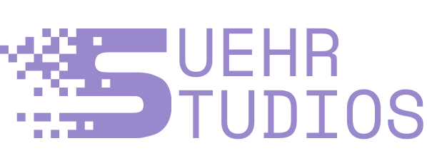

# C3 Corvette Console

Beautiful slick embedded touch-enabled GUI console for the C3 Chevrolet Corvette (target 1975 model). Built in C++20 from scratch for a Raspberry Pi CM4 and ESP32 sensor/control board. Integrates with engine using piggyback taps on existing electronic sensors to ensure nothing is irreversible.

## What Exactly Is This?

A large portrait touchscreen display in the center console dashboard of the car. Yes, it requires physically modifying the dashboard of car and connecting to or modifying existing electronics. It shows auxiliary gauges, supports controlling HVAC/lamps/audio, and enables CarPlay so that iPhone/Android can be connected. The ESP32 (MCU) owns sensor acquisition, warning outputs, and relay controls. The Pi owns the interface and CarPlay, camera, and audio integrations. Factory gauges and the headlamp switch stay connected and defrost must remain reachable with software for safety.

## Developer Documentation

Start with the **[developer guide](docs/c3console-developer-guide.md)** for hardware and software architecture, Mermaid diagrams, runtime behavior, feature-extension recipes, testing, troubleshooting, and the remaining hardware gates.

- [1975 Corvette wiring notes](docs/1975-corvette-wiring-notes.md)
- [1975 Corvette dashboard dimensions](docs/1975-corvette-dash-dimensions.md)
- [Build specification](docs/c3console-build-spec.md)
- [Learning notes](docs/c3console-learning-handbook.md)
- [UI/UX mockup](mockups/c3console-ui-mockup.html)

## Desktop Development Quickstart

```sh
cmake -B build -DC3_BACKEND=desktop -DCMAKE_BUILD_TYPE=RelWithDebInfo
cmake --build build -j
ctest --test-dir build --output-on-failure
./build/c3console --desktop --source=mock --profile=WarmupDrive
```

See the [guide's build instructions](docs/developer-guide.md#4-building-and-running) for dependencies, ARM64 container builds, firmware, recording/replay, and screenshots.

> 
>
> Copyright © 2026 Tyler R. Suehr
