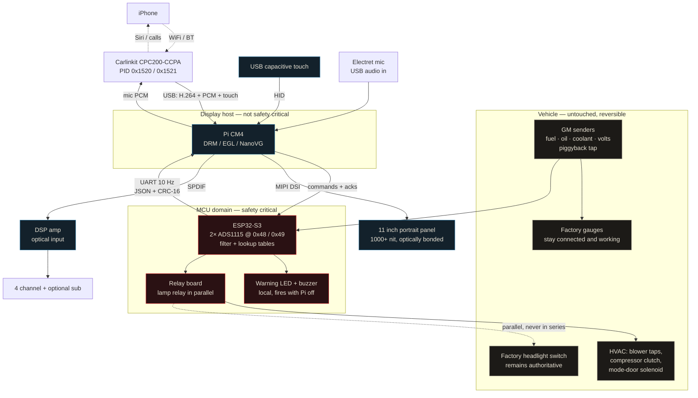

# C3Console – Build Specification

**Vehicle:** 1975 Chevrolet Corvette Stingray coupe (C3), 350 small-block; L48 or L82.

**Goal:** Portrait touchscreen center console running custom C++ software. Auxiliary gauges rendered around an embedded CarPlay surface. Digital audio source feeding an outboard DSP amp. Screen-based HVAC control with mechanical fallback. Screen-based lamp control in parallel with the factory switch, never in series.

**Governing principle:** nothing irreversible until Tier 6. Every sender is read by piggyback tap, factory gauges stay connected and functional, and the original bezel is stored unmodified while a reproduction is cut.

---

## 1. System Architecture


**Division of responsibility.** The ESP32 owns everything real-time and everything safety-adjacent: sensor acquisition, filtering, unit conversion, relay drive, and the independent warning path. The Pi owns only display, CarPlay, and audio. If the Pi dies, the car still has working factory gauges, working HVAC relays in their last state, a working headlight switch, and a working warning buzzer.

That split is the whole safety story. Respect it.

---

## 2. Bill of Materials

### Display and compute

| Item | Spec | Est. |
|---|---|---|
| LCD panel | 10.1–11.6" portrait, 1000+ nit, optically bonded, MIPI or eDP + driver board | $600–900 |
| Touch digitizer | USB capacitive, matched to panel, HID-compliant | incl. |
| Compute module | Raspberry Pi CM4, 4GB RAM, 32GB eMMC, WiFi variant | $80 |
| Carrier board | CM4 carrier with USB host, MIPI DSI, GPIO header | $50 |
| Heatsink + blower | Active cooling, 40mm | $20 |

Choose **CM4 over Pi 5**. CM4 retains the hardware H.264 decode block, giving you a zero-copy DMA-BUF decode path at much lower thermal load. Pi 5 decodes in software — faster on paper, worse in a closed fiberglass cabin in August.

### Sensor and control board

| Item | Spec | Est. |
|---|---|---|
| MCU | ESP32-S3 DevKit or Teensy 4.0 | $15 |
| ADC | 2× ADS1115, 16-bit, I2C addr 0x48 / 0x49 | $8 |
| Protection | BAT54S clamp diodes, 10k/100nF RC per channel, TVS on 12V rail | $15 |
| DC-DC | Automotive-rated buck, 9–36V in, 5V/5A out, load-dump rated | $35 |
| Supercap module | 5V supercap UPS for graceful shutdown | $30 |
| Relay board | 6× SPDT automotive 30A with sockets and flyback diodes | $40 |
| Vacuum solenoids | 12V 3-way, for HVAC mode doors | $50 |
| PCB | 2-layer, 100×80mm, JLCPCB 5-off | $25 |
| Rotary encoder | Detented, panel mount, for volume | $12 |
| Piezo buzzer + LED | Warning path, panel mount | $10 |

### CarPlay and audio

| Item | Spec | Est. |
|---|---|---|
| CarPlay dongle | **Carlinkit CPC200-CCPA** or CPC200-Autokit or CCPM | $60 |
| Digital output | HiFiBerry Digi+ Pro (SPDIF/optical out) | $50 |
| USB audio in | Generic USB sound card, mic input | $20 |
| Microphone | Automotive electret, A-pillar mount | $25 |
| DSP amplifier | 4–6 channel with **optical input**, Helix or Audison class | $500–800 |

> **Critical purchasing note.** The dongle must be the type that converts *Android head units* to CarPlay — CPC200-CCPA, CPC200-Autokit, or CCPM. The wired-to-wireless adapters (Carlinkit U2W, 3.0/4.0) present a completely different USB interface and **will not work**. Expect the USB product ID to be either 0x1520 or 0x1521 depending on production batch; confirm with `lsusb` before writing your udev rule.

### Bench and simulation rig

| Item | Spec | Est. |
|---|---|---|
| Spare GM senders | Used temp, oil pressure, fuel — for bench calibration | $60 |
| Resistance decade box | 0–1kΩ, 1Ω steps | $35 |
| Thermocouple + meter | K-type, for coolant calibration | $30 |
| Hand pressure pump | 0–100 psi with mechanical reference gauge | $45 |
| Bench supply | 0–30V 5A, current limited | $80 |
| Breadboard, pots, wire | 10k linear pots ×4 | $25 |

### Install

| Item | Spec | Est. |
|---|---|---|
| Reproduction bezel | C3 center console bezel, to be cut | $180 |
| ABS sheet, filler, paint | Fabrication consumables | $80 |
| Aux fuse block | 6-circuit, blade fuse | $35 |
| Power/ground kit | 8 AWG OFC, 60A ANL holder | $60 |
| Wire, terminals, loom | 16/18 AWG, adhesive heat-shrink terminals | $80 |
| Crimper | Ratcheting, for insulated and open-barrel | $45 |

**Totals:** compute and display ~$750 · sensor/control ~$240 · CarPlay/audio ~$655–955 · bench rig ~$275 · install ~$480. **Project total ≈ $2,400–2,700**, excluding speakers and sound deadening from the earlier audio spec.

---

## 3. Sensor Interface

### 3.1 What the car provides

The specified senders are single-wire resistive devices grounded through the block or tank.

| Parameter | Sender type | Nominal range | Notes |
|---|---|---|---|
| Fuel level | Resistive float, GM standard | 0 Ω empty → 90 Ω full | In-tank, slow |
| Oil pressure | Resistive diaphragm | ~1 Ω @ 0 psi → ~90 Ω @ 80 psi | Fast, noisy |
| Coolant temp | NTC thermistor | ~1365 Ω @ 100 °F → ~55 Ω @ 250 °F | Strongly nonlinear |
| System voltage | — | 12–15 V | Direct measurement |

Treat every figure above as a starting hypothesis. Fifty-year-old senders drift, and the aftermarket replacements in the car may not be GM-spec at all. **Everything gets calibrated empirically in Tier 3.**

### 3.2 The piggyback read

Do not cut the sender wires and do not remove the factory gauges. Instead, tap the junction between the factory gauge and the sender, and measure the *voltage* at that node. The factory gauge continues to supply excitation current, the node voltage varies monotonically with sender resistance, and pulling the whole system out later returns the car to stock.

One tap wire per sender. No splices in the original harness — use insulation-piercing taps only as a temporary Tier 6 measure, then replace with a proper soldered pigtail at the gauge terminal during permanent install.

### 3.3 Differential measurement — why two ADCs

The senders ground through the engine block and the fuel tank, not through your board. Ground offset between the block and the console on a car this age is routinely 100–200 mV, which is a large fraction of a 0–90 Ω reading.

So measure **differentially**, referencing each channel to its own sender ground. The ADS1115 offers four single-ended channels *or* two differential pairs, so four differential channels needs two chips:

| ADC | Address | Channel | Assignment |
|---|---|---|---|
| #1 | 0x48 | A0–A1 diff | Fuel level |
| #1 | 0x48 | A2–A3 diff | Oil pressure |
| #2 | 0x49 | A0–A1 diff | Coolant temp |
| #2 | 0x49 | A2 single | System voltage via 47k/10k divider |

Per-channel front end: 10 kΩ series resistor, 100 nF to local ground, BAT54S clamping to the ADC rails, then a divider placing worst-case voltage inside the ±4.096 V PGA range. The ADS1115 runs from 3.3 V, so no input may exceed about 3.6 V regardless of the PGA setting.

**Sampling rate.** Four channels at 8 SPS cannot fill a 10 Hz frame: one conversion takes 125 ms. The firmware runs single-shot conversions at 128 SPS (7.8 ms), both chips in parallel, five samples per channel per 100 ms tick, median-of-5, then the IIR of §3.4. The IIR is where the noise budget is spent; the ADC rate only has to keep up with the frame.

### 3.4 Filtering

Per channel, on the MCU:
- Median-of-5 to reject ignition spikes
- Then a first-order IIR, α tuned per channel: fuel very slow (τ ≈ 10 s, it sloshes), coolant slow (τ ≈ 2 s), oil pressure fast (τ ≈ 200 ms, you want to see it drop)
- Then lookup-table conversion to engineering units
- Then range validation: out-of-range reads a sender fault, not a value

**Range validation.** The check runs on raw counts, per channel, before conversion. With the piggyback read an open sender lets the node float to the gauge supply, so *open* is a reading above 97 % of full scale on fuel, oil and coolant. *Short* is only flagged on the coolant NTC (below 1 % of full scale): a GM fuel float reads 0 Ω at empty and the oil sender about 1 Ω at 0 psi, so for those a short is indistinguishable from the low end, and 0 psi already raises `OIL_LOW`, which is the safe direction. The voltage channel has no window; `VOLT_LOW` covers it. These percentages are starting points; the bench sweep (§9.2) replaces them. A channel with a sender fault contributes no value fault.

The filter runs on raw counts and the lookup runs on the filtered count, because the coolant lookup is nonlinear.

Emit engineering units over the wire. The Pi never sees a raw count except in the calibration screen.

---

## 4. MCU ↔ Pi protocol

Newline-delimited JSON over UART, 115200 8N1, 10 Hz. Human-readable, trivially loggable, trivially replayable. At this data rate the parsing cost is irrelevant.

### 4.1 Telemetry, MCU → Pi

```json
{
    "t": 184523,
    "fuel": 0.62,
    "oil": 41.2,
    "clt": 196.4,
    "volt": 14.1,
    "faults": [],
    "raw": {
        "fuel": 12843,
        "oil": 8211,
        "clt": 19004,
        "volt": 21877
    },
    "relays": {
        "blower": 2,
        "ac": true,
        "mode": "vent",
        "headlights": false,
        "doors": false
    },
    "rev": false,
    "crc": "a3f1"
}
```

| Field | Type | Units |
|---|---|---|
| `t` | uint32 | MCU milliseconds since boot |
| `fuel` | float | Fraction, 0.0–1.0 |
| `oil` | float | psi |
| `clt` | float | °F |
| `volt` | float | volts |
| `faults` | string[] | `OIL_LOW`, `CLT_HIGH`, `FUEL_LOW`, `VOLT_LOW`, `VOLT_HIGH`, `SENDER_OPEN_<ch>`, `SENDER_SHORT_<ch>` with `<ch>` in `FUEL OIL CLT VOLT`; at most 8 |
| `raw` | object | Raw ADC counts, for the calibration screen |
| `relays` | object | The MCU's actual relay state, re-asserted every frame: `blower` 0–4, `ac` bool, `mode` `vent`\|`floor`\|`defrost`, `headlights` bool, optional `doors` and `high` bools |
| `rev` | bool | Reverse gear, from the reverse-lamp circuit through an opto; drives the camera surface |
| `crc` | hex | CRC-16/CCITT-FALSE, see below |

Always include `raw`. You will want it the first time a gauge reads wrong on the car, and adding it later means reflashing in a driveway.

**Wire rules.**
- **CRC variant:** CRC-16/CCITT-FALSE, polynomial 0x1021, initial value 0xFFFF, no reflection, no final XOR; check value `crc("123456789") == 0x29B1`. It is computed over the object exactly as the MCU serialised it before appending the crc member, i.e. over the line with the `,"crc":"xxxx"` substring removed and the closing brace kept. `crc` must be the last member. Firmware and host share one implementation, `src/telemetry/crc16.h`.
- `relays.doors` is an optional boolean in revision 3, `relays.high` (high-beam relay) in revision 4; the host treats either as unknown until a frame carries it and will not send a lamp command that would overwrite an unknown member. When `relays` is present, `blower`, `ac`, `mode` and `headlights` must each appear once; duplicate fields and incomplete objects are rejected. Missing feedback is unknown; the host does not infer door position from a sent command. Relay feedback describes commanded outputs, not measured lamp/door position or the factory switch.
- `t`, `fuel`, `oil`, `clt`, `volt` and `faults` are required; `raw`, `relays` and `rev` are optional so early firmware can omit them. Unknown keys are skipped, so fields can be added without breaking an older host.
- **Plausibility limits, not thresholds:** the host rejects a frame as corrupt when fuel is outside 0–1, oil outside 0–200 psi, coolant outside −40–400 °F or volts outside 0–40 V. Rejected frames are counted and never rendered. Nothing on the host compares a value to a warning threshold.
- Lines longer than 512 bytes are dropped. A bad CRC is counted separately from a malformed line so a bench log can tell noise from a firmware bug.

### 4.2 Commands, Pi → MCU

```json
{"cmd":"hvac","blower":2,"ac":true,"mode":"vent"}
{"cmd":"lamp","headlights":true,"doors":false,"high":false}
{"cmd":"cal","ch":"fuel","action":"add","raw":12843,"value":0.50}
{"cmd":"cal","ch":"fuel","action":"save"}
{"cmd":"ping"}
```

The MCU acknowledges every command with `{"ack":"hvac","ok":true}`, or `{"ack":"hvac","ok":false,"err":"blower must be 0..4"}` when it refuses one, and re-asserts its full relay state in each telemetry frame so the Pi's UI can never drift out of sync with reality.

**Host command transactions.** A tap submits intent; the dock continues to display the MCU's reported state. One transaction is outstanding at a time. Confirmation requires an `ok:true` acknowledgement of the same command kind followed by matching relay telemetry; rejection and a 1 s timeout are visible. The protocol has no transaction identifier, so a timeout quarantines further commands for that process session rather than risking a late acknowledgement confirming another request. Replay has no command transport. Unknown relay feedback disables controls; missing door feedback disables lamp-group changes that would otherwise overwrite an unknown door state. The MCU still holds its last output state on host loss.

**Command rules.**
- `hvac` needs all three of `blower`, `ac`, `mode`; `lamp` needs `headlights`, and `doors` (headlight doors, revision 2 addition) and `high` (high beams, revision 4) are optional and keep their last state when absent. The host clears `high` whenever it sends `headlights:false` and sets `headlights:true` whenever it sends `high:true`. A command with a missing or malformed field is rejected whole, so a relay never moves on half a message.
- `cal add` inserts or replaces a point in an initially empty staging table for that channel. It never changes the active conversion or its provenance. `cal save` requires 8–24 measured points, persists a snapshot on a separate MCU task, and activates it only after persistence succeeds. Failed saves retain the prior active curve and staging points. Provenance is per channel; loading one measured channel does not certify another.
- `replay` is not an MCU command in this build: playback is done by the display host from its own CSV (§9.3). The MCU rejects it with an explanation.
- Unknown keys are ignored; unknown `cmd` values are rejected.

### 4.3 Failure behavior

- **MCU sees no command for 5s:** hold current relay state. Do not fail HVAC to off; losing the blower on a hot day is worse than leaving it running.
- **Pi reaches 1s without fresh telemetry:** gauges grey out and display a comms fault. Never display a stale value as though it were live.
- **Warning path:** entirely local to the MCU. Low oil pressure or high coolant temp drives the LED and buzzer directly from GPIO, regardless of UART state, regardless of whether the Pi is even powered.

**Thresholds and hysteresis.** Each fault sets at one level and clears at a safer one so a reading on the line does not chatter the buzzer. The desktop `MockSource` simulates the same numbers so the UI behaves identically against both.

| Fault | Sets | Clears | Warning path |
|---|---|---|---|
| `OIL_LOW` | < 12 psi | ≥ 15 psi | LED always; buzzer only while the alternator is charging (≥ 13.2 V), so 0 psi at key-on-engine-off is silent |
| `CLT_HIGH` | > 235 °F | ≤ 228 °F | LED and buzzer, unconditionally |
| `FUEL_LOW` | < 8 % | ≥ 10 % | none |
| `VOLT_LOW` | < 12.4 V | ≥ 12.8 V | none |
| `VOLT_HIGH` | > 15.2 V | ≤ 14.9 V | none |

A dead I2C bus is reported as every sender open, never as a frozen value.

---

## 5. Display host software

### 5.1 Repository layout

File names are `snake_case`; the earlier CamelCase names in this section were illustrative.

```
c3console/
├── CMakeLists.txt
├── src/
│   ├── main.cpp                  # parse → resolve → run_console(); one path for both backends
│   ├── app/                      # config, CLI, event loop, render loop, controls, surfaces,
│   │                             # settings store, headless runner, source factory
│   ├── render/                   # console_scene, layout, theme, units, alerts, dock, sheets,
│   │                             # status tools, camera surface, widgets, icons, fonts
│   ├── platform/                 # display_backend.h, input_source.h, watchdog.h seams;
│   │                             # desktop_backend + sdl_input (SDL2/GL3), drm_backend +
│   │                             # libinput_source (KMS/GBM/EGL/GLES2), rotation.h, file_watchdog
│   ├── telemetry/                # sensor_source.h, frame.h, protocol (parser), crc16.h,
│   │                             # mock_source, uart_source, replay_source, csv_codec,
│   │                             # csv_recorder, calibration, limits.h, snapshot.h
│   ├── vehicle/                  # relay state, command/ack codec, CommandSink seam
│   ├── logging/                  # bounded formatting; sinks selected by execution context
│   ├── audio/                    # audio_state.h (AudioSink seam); ALSA/DSP stage to come
│   ├── carplay/                  # dongle (libusb), decoder (V4L2 M2M), touch bridge — to come
│   └── utils/                    # allocation-free helpers, no project dependencies:
│                                 # fixed_vector, triple_buffer, unique_fd, parse_number, ...
├── firmware/esp32/               # PlatformIO; lib/c3fw is pure logic shared with the host tests
├── config/                       # console.toml, calibration.json (placeholder)
├── tools/docker/                 # Bookworm arm64 build container (target toolchain + tidy)
├── tools/replay/                 # CSV format notes; record/replay live in the console itself
├── tests/                        # Catch2; also runs the firmware logic against the host parser
└── docs/                         # this spec, milestones.md, UI design notes, mockups, bench guide
```

### 5.2 The abstraction that makes this buildable

`DisplayBackend` and `SensorSource` are the two seams that let the entire application run on your laptop with no hardware attached:

```cpp
// Selected at runtime from config or CLI
// (illustrative; the real names are snake_case and take Options structs)
auto display = args.desktop ? makeDesktopBackend(1668, 2388)
                            : makeDrmBackend("/dev/dri/card0");

auto sensors = [&]() -> std::unique_ptr<SensorSource> {
    switch (args.source) {
        case Source::Uart:   return makeUartSource("/dev/ttyAMA0");
        case Source::Mock:   return makeMockSource(MockProfile::WarmupDrive);
        case Source::Replay: return makeReplaySource(args.replayFile);
    }
}();
```

Write these two interfaces first, before any rendering code. Everything downstream depends on getting this seam right, and retrofitting it later is miserable.

### 5.3 Event loop

One event-loop thread, waiting on:
- UART fd (telemetry)
- libusb fds from `libusb_get_pollfds()` (dongle)
- libinput fd (touch)
- DRM fd (pageflip completion)
- a 60 Hz render tick

The wait is `poll(2)` with a computed timeout rather than `epoll` plus `timerfd`: at five descriptors the two are indistinguishable, and `poll` also runs on macOS where the desktop build lives (`src/app/event_loop.cpp`; the wait primitive is one function if `epoll` is ever wanted). The tick is paced with no catch-up bursts, and the watchdog is kicked only after a tick that successfully presents and continues.

H.264 decode runs on one worker thread feeding a triple-buffered frame queue. Sensor state crosses to the render path through a **triple-buffered** snapshot with an atomic index (`src/util/triple_buffer.h`): two slots cannot rule out a torn read once the producer sits on another thread, three keep every slot single-owner. No locks in the render path, no heap allocation after init.

**Execution boundaries.** `TelemetryIngestor` records every valid frame before publishing the latest presentation snapshot; each pump processes at most 32 frames. `UartSource` owns both directions of its descriptor and returns frames in order, retaining unconsumed input bytes. The render tick uses one `TelemetryView` for gauge, well and control freshness. `[telemetry] stall_timeout_ms` accepts 1–1000 ms; a failed source is unavailable immediately.

`BackgroundIo` owns runtime CSV writes, settings persistence, stderr output and local-time conversion. Render-side enqueue is fixed-capacity and nonblocking: 256 CSV frames and 128 log lines; overflow drops new items and is counted and reported at shutdown. Settings use a latest-value triple buffer, so rapid commits coalesce. Shutdown joins the worker and drains accepted work before reading recorder counters. Sudden power loss can lose queued recordings or an unpersisted settings change. The screenshot mode intentionally performs synchronous capture and is a development aid, outside the production timing guarantee. Tick CPU measurements include ingestion, input, model updates and draw calls before presentation; source-read callbacks are additional work between ticks.

`DisplayBackend::end_frame()` returns `PresentResult`. A failed swap or flip stops rendering with an error, without another watchdog kick or watchdog magic close. A flip timeout retains both potentially scanned-out buffers until KMS restoration or detach succeeds. If teardown cannot detach, the process exits immediately with those buffers retained for kernel cleanup. GBM framebuffer metadata uses a fixed cache. Native scanout recovery and timing require the §11 rig tests.

The MCU checks sampling deadlines before command work, reads at most 64 available bytes per loop without a stream timeout, and writes at most 64 bytes already admitted by UART capacity. A fixed eight-line transmit queue drops on overload; UART progress never gates warning evaluation. MCU persistence uses fixed-storage FreeRTOS mailboxes with zero queue wait, because ESP32 libstdc++ does not guarantee lock-free atomics. Flash/cache stalls and warning deadlines during NVS writes still require bench measurement.

C++20 is available on Bookworm with GCC 12. Use it, but keep the render loop allocation-free and exception-free.

### 5.4 Compositing, in two stages

**Stage 1 — ship this first.** Decode to DMA-BUF, import via `EGL_EXT_image_dma_buf_import`, sample as a GL texture, draw gauges around it in NanoVG. Zero-copy, moderate code, works.

**Stage 2 — the good version.** DRM atomic modesetting with multiple planes: the decoded YUV frame goes on an overlay plane, the gauge UI on the primary plane with per-pixel alpha. The vc4 display controller composites during scanout, so CarPlay video costs zero GPU time. Uses `drmModeAtomicCommit`, no SDL.

Do not attempt stage 2 until stage 1 is running in the car.

### 5.5 CarPlay geometry and touch

The dongle protocol lets you request video mode — width, height, fps, DPI — at session init. Request **exactly** the pixel dimensions of your center well. CarPlay supports dynamic screen sizing and does not require 16:9, so a tall non-standard rectangle is fine and you get no letterboxing or rescaling.

Touch is one USB HID device. Per event, decide:

```cpp
if (layout.carplayRect.contains(pt)) {
    auto local = layout.carplayRect.toLocal(pt);
    dongle.sendTouch(local, phase);   // forward over USB
} else {
    ui.dispatch(pt, phase);           // handle locally
}
```

CarPlay has no idea it's living in a sub-rectangle. It's a video surface you composite and a touch stream you feed.

**Panel geometry.** The panel is **800 × 1280** and the layout is drawn at 2× against a **1600 × 2560** reference (`docs/c3-console-mockup-v6.html`), replacing the revision 2 iPad geometry. At the reference: 88 px status bar with the brand mark centred and the theme button at the right; the CarPlay well on top, **1520 × 1392**, snapped to 16 px on both axes so the mode requested from the dongle needs no crop; a 64 px tab bar (CarPlay, Camera, Settings) under it; a 528 px cluster with the fuel bar and a Systems card (MCU and CarPlay link chips) on the left and the two arc gauges to the right; a 392 px dock of two islands, Lights (doors, lights, high beams) and HVAC (mode, blower, A/C); and the 36 px lever hint. At 1× every rect halves to whole pixels. The layout stays proportional for other panels (`docs/c3-console-ui-design.md`). Panels usually scan out landscape; `[display] rotation` (0, 90, 180, 270, clockwise) is applied identically to drawing and to touch (`src/platform/rotation.h`), so scene code always sees portrait.

**The well is a surface slot.** It shows, in priority order, the rear camera (reverse in a live frame, 2 s hold after it clears, or the Camera tab), the settings surface (a root list of Audio, Theme, Units, Calibration and System pages, one level deep, with a back arrow below the root and a close button that always returns to CarPlay), or CarPlay. The tab bar under the well chooses; tapping Settings while it is open returns to its root. A gesture is captured by its recipient on touch-down. Crossing the well boundary does not transfer it; CarPlay coordinates are clamped to the well. A surface takeover sends cancellation and suppresses the remaining release. Cancellation never activates a button and rolls back an uncommitted slider preview. Both input backends track one contact independently of their event queue. The dongle bridge itself remains a later milestone.

### 5.6 Platform hardening

- Raspberry Pi OS Lite, Bookworm, 64-bit. No desktop, no X, no Wayland.
- **Read-only rootfs via overlayfs.** This single change eliminates the entire class of corruption-on-power-loss failures. `/var/log` to tmpfs, journald volatile.
- eMMC, not SD.
- Hardware watchdog: `bcm2835_wdt`, `/dev/watchdog`, kicked from the render loop. If frames stop, the box reboots.
- systemd unit with `Restart=always`, `RestartSec=2`.
- No swap.
- GPIO ignition-sense line; on ignition-off, finish the frame, sync, and halt. Supercap carries the 2–3 seconds needed.
- Target: **under 10 s from ignition to first gauge frame.** CarPlay session negotiation adds another 10–20 s and that's outside your control, so draw gauges immediately and show a connecting state in the well.
- **Writable data partition (revision 2).** A small separate partition, mounted at `/data`, holds the two files the console writes: `settings.toml` (user preferences: theme `dark|light|auto`, accent `0xRRGGBB`, temperature `F|C`, pressure `psi|bar`, the same `[ui]` keys as `console.toml`, written atomically with temp file, fsync, rename and directory fsync) and, later, the in-car `calibration.json`. A missing or corrupt file falls back to the shipped defaults and says so; it never stops the console from starting. Config: `[ui] settings_file`, `[platform] watchdog_device`.
- The watchdog is kicked only after successful presentation on a continuing render tick and receives the magic close on a clean exit so a deliberate stop does not reboot the box.

---

## 6. HVAC control

The 11" portrait screen covers the factory heater and A/C controls. This is therefore not optional — it's on the critical path for the screen to be installable at all.

### 6.1 Phase one: the 80% version, one weekend

| Function | Method | Difficulty |
|---|---|---|
| Blower speed | Relays switching the factory resistor pack taps | Easy |
| Compressor clutch | Single relay | Easy |
| Recirc / vent door | 12V vacuum solenoid replacing the vacuum switching valve | Moderate |
| Temperature blend | **Keep the factory cable lever**, protruding through a slot below the screen | None |

Use relays for the blower, not PWM. It's a 15–20 A inductive load and a high-side driver capable of it is a project in itself. Relays with flyback diodes, done.

**Outputs.** Blower speed 1–4 energises exactly one of four relays on the resistor-pack taps, break-before-make, and speed 0 energises none. The compressor clutch relay is refused while the blower is off. Mode is two vacuum solenoids: floor and defrost energise one each, vent releases both. Outputs change only on a command and hold otherwise (§4.3). The pin map lives in `firmware/esp32/include/pins.hpp` and is provisional until confirmed against the relay board.

### 6.2 Phase two, optional

Electric blend door via stepper or linear actuator with position feedback. Real work, genuinely nice, not needed to drive the car.

### 6.3 Non-negotiable

**Defrost must be reachable without software.** It's a visibility-safety function. Either keep a mechanical defrost position on the retained lever, or fit a dedicated hard-wired defrost switch that drives the solenoid directly, bypassing the MCU entirely.

---

## 7. Lamps and headlight doors

Headlights are safety-critical and in most jurisdictions a functioning headlamp switch is an inspection item. So:

**The factory headlight switch stays hard-wired and authoritative.** Screen control is added *in parallel*, via a relay wired across the factory switch contacts. Either can energize the lamps, independently.

Failure analysis:
- Relay fails open → factory switch still works. Fine.
- Relay fails closed → lights on continuously. Annoying, drains the battery when parked, but never leaves you dark. Acceptable.
- Pi kernel panics at night → factory switch unaffected. Fine.

**Never put the Pi or the MCU in series with the lamp circuit.** That is the one design rule here that has no exceptions.

High beams follow the same rule: a second relay in parallel with the dimmer's high-beam output (light green, bulkhead 13/14), never in series with the dimmer, driven by the `high` field of the `lamp` command. The floor dimmer stays authoritative.

Headlight doors are vacuum-actuated and separate from the lamps. Retain the factory override switch; screen control of the doors is the low-risk half and can go on the same relay board: one door relay, driven by the `doors` field of the `lamp` command (§4.2).

---

## 8. Power distribution

```
Battery + (behind driver's seat)
  └─ 60A ANL fuse (within 18" of battery)
      └─ 8 AWG ─► AUX FUSE BLOCK (behind console)
            ├─ 10A ─► automotive DC-DC ─► Pi 5V rail + supercap
            ├─ 10A ─► ESP32 board + ADS1115 rails
            ├─ 20A ─► relay board common (HVAC, lamp parallel relay)
            └─ 40A ─► DSP amplifier
                        (amp remote from Pi GPIO via opto)

RELAY (30A) — master accessory
  pin 86 ◄── trigger from factory radio ACC feed
  pin 85 ──► ground
  pin 30 ◄── fused 20A from aux block
  pin 87 ──► DC-DC enable + MCU enable

IGNITION SENSE ──► optocoupler ──► Pi GPIO (shutdown trigger)

GROUND — single star point on the steel birdcage,
sanded to bare metal, star washer, dielectric grease
  ├─ Pi / DC-DC: 12 AWG
  ├─ MCU board: 16 AWG
  └─ DSP amp: 8 AWG

Power down one rocker panel, audio and signal down the other
```

The master relay means the ignition switch carries only coil current, and nothing draws parasitically when the car sits. The ignition-sense opto is what lets the Pi shut down gracefully instead of being guillotined.

Keep audio digital from the Pi to the amp. On a fiberglass car with points ignition, optical out eliminates the entire ground-loop and alternator-whine problem class before it starts.

---

## 9. Simulation ladder

This is the part that lets you build almost the whole thing before touching the car. Each tier is a complete, testable stage.

| Tier | What it is | Car modified? | Validates |
|---|---|---|---|
| **0** | Browser mock (`docs/c3console-ui-mockup.html`) | No | Layout, legibility, touch targets, gauge design, interaction model |
| **1** | Desktop C++ build, `DesktopBackend` + `MockSource` | No | The real renderer, the real UI code, the real state machine |
| **2** | ESP32 + ADS1115 + potentiometers on a breadboard, feeding real UART into the desktop app | No | Firmware, protocol, CRC, fault handling, end-to-end data path |
| **3** | Bench sender rig — real GM senders, thermocouple, pressure pump | No | Calibration tables, nonlinearity, the numbers that actually matter |
| **4** | Replay — MCU plays back recorded CSV | No | Deterministic regression testing |
| **5** | Pi + panel + dongle on the bench, 12V supply | No | Boot time, thermals, H.264 decode, compositing, CarPlay session |
| **6** | Temporary in-car — piggyback taps, screen on a bracket, nothing cut | **No** | Real sender behavior, EMI, heat, sunlight, the drive experience |
| **7** | Permanent install — cut repro bezel, fabricate, loom, finish | Yes | — |

Tiers 0 through 5 need no car at all. Tier 6 needs no *irreversible* change, because the piggyback tap leaves the factory gauges intact. You can validate roughly 90% of this project with the Corvette sitting untouched in the garage.

### 9.1 Tier 1 in detail — the mock physics model

`MockSource` should generate telemetry that is plausible enough to shake out real UI bugs. Model, don't randomize:

```
Coolant:   first-order warmup toward thermostat setpoint (~195 °F),
           overshoot on idle after shutdown-restart, drop with road speed
Oil:       f(rpm, coolant temp) — high when cold, ~40 psi hot at cruise,
           ~15 psi hot idle. This is the gauge that must look right.
Fuel:      monotonic drain plus a slosh term when "cornering"
Volts:     ~14.2 V charging, dips on blower and headlight load,
           ~12.6 V key-on engine-off
```

Ship named profiles: `ColdStart`, `WarmupDrive`, `HotIdle`, `HighwayCruise`, plus fault profiles `OilPressureLoss`, `Overheat`, `SenderOpen`, `AlternatorFail`, and `LinkLoss` (drives normally for 10 s, then the UART goes silent) so the stale-out path of §4.3 is exercised on every desk. You want to see how the UI behaves in an emergency long before you experience one.

### 9.2 Tier 3 in detail — calibration procedure

For each sender, build a lookup table of at least 8 points with linear interpolation between them.

**Coolant temp.** Spare sender in a pot of water on a hotplate, K-type thermocouple beside it, ADC reading logged. Sweep 70 °F to boiling, record every 20 °F. Extrapolation above 212 °F is unavoidable without a glycol bath — accept it and set your overheat alarm conservatively low.

**Oil pressure.** Spare sender on the hand pump with the mechanical gauge tee'd in. Record every 10 psi, 0 to 80.

**Fuel level.** Easiest on the bench with the sender out and the float arm swept by hand between its stops, recording ADC counts at measured arm angles. Then correct in-car: run the tank near dry, add fuel in measured 2-gallon increments, record. Tank geometry is not linear with float angle and no amount of bench work substitutes for this step.

**Voltage.** Two-point against a calibrated meter. Trivial.

Store as `config/calibration.json` and expose a hidden calibration screen in the UI that shows raw counts alongside converted values and lets you capture a point with one tap. You will use this in a hot garage with greasy hands; make it work with one finger.

**File format.**

```json
{
    "placeholder": true, 
    "format": 1,
    "channels": {
        "fuel": {
            "points": [
                {
                    "raw": 0, 
                    "value": 0.0
                }, 
                {
                    "raw": 32767, 
                    "value": 1.0
                }
            ]
        },
        "oil": {...}, 
        "clt": {...}, 
        "volt": {...}
    }
}
```

At least 2 and at most 24 points per channel, strictly increasing `raw`; linear between points and linearly extrapolated beyond the ends (coolant above 212 °F is always an extrapolation). The shipped file is `"placeholder": true` with identity-shaped curves, and the console refuses to load a file that claims `"placeholder": false` unless every channel has at least 8 points. `tools/generate_calibration.py` generates the firmware defaults from this file; a host test rejects drift. The shared `util::LinearCurve` implements interpolation on both processors. The firmware replaces defaults per channel only after a validated `cal save` succeeds.

### 9.3 Tier 4 in detail — record everything

From Tier 6 onward, log every telemetry frame to CSV. Every drive becomes a replay corpus. When a gauge misbehaves on the road, you reproduce it at your desk instead of guessing.

```
timestamp_ms,fuel_raw,oil_raw,clt_raw,volt_raw,fuel,oil,clt,volt,faults
```

Raw counts *and* converted values in the same row. That way a calibration change can be re-evaluated against historical drives without re-driving them.

**Row rules.** `timestamp_ms` is the MCU's `t`, so playback paces on its deltas and a stall on the road replays as a stall on the desk (gaps over 10 s are shortened to 10 s; after the last row the link reports failed, and the gauges grey out). `faults` joins the codes with `|` and is empty when clear; no field is ever quoted. Values are written as fuel `%.4f`, oil `%.2f`, clt `%.2f`, volt `%.3f`. `relays` and `rev` are not recorded. Rows that fail to parse are counted as malformed and skipped. The console records with `--record=PATH` from any source and plays back with `--replay=PATH`.

---

## 10. Build order

Reordered so the highest-risk and highest-dependency items come early.

**Phase 1 — Software foundation (weeks 1–3, no hardware)**
1. Iterate the browser mock until the layout is settled
2. CMake project, `DisplayBackend` and `SensorSource` interfaces
3. `DesktopBackend` (SDL2 + GL), `MockSource` with physics profiles
4. Port the canvas gauge code to NanoVG, build the full UI on the laptop

**Phase 2 — Sensor chain (weeks 4–6, bench)**
5. ESP32 firmware: ADS1115 differential reads, filtering, JSON emit, CRC
6. Breadboard with pots, verify end-to-end into the desktop app
7. Warning path: LED and buzzer on GPIO, independent of UART
8. Relay board and HVAC command handling — early, because the screen can't be installed without it
9. Bench sender rig, build calibration tables

**Phase 3 — Pi target (weeks 7–9, bench)**
10. OS image: Bookworm Lite, overlayfs read-only, watchdog, systemd
11. `DrmBackend` — GBM + EGL, gauges only. Measure boot and frame time
12. **Build FastCarPlay unmodified and get CarPlay on the panel.** Highest-risk step in the project; if the dongle path fails on your hardware you need to know now
13. Merge: decode to DMA-BUF, import as EGLImage, composite gauges around it
14. Touch transform and forwarding
15. Audio: SPDIF out, USB mic in, volume encoder

**Phase 4 — Car, reversible (weeks 10–12)**
16. Power distribution, master relay, star ground, ignition sense
17. Piggyback taps on all four senders
18. In-car calibration correction, especially fuel
19. Screen on a temporary bracket. Drive it. Log everything
20. HVAC relays and solenoids, defrost fallback verified

**Phase 5 — Permanent (weeks 13+)**
21. Cut the reproduction bezel, fabricate the mount, vent the enclosure
22. Lamp parallel relay with failure-mode verification
23. Permanent loom, soldered pigtails, strain relief
24. DRM atomic planes, if you still want it
25. Store the original bezel and radio, labeled

---

## 11. Acceptance tests

Do not advance a phase until its tests pass.

**Sensor chain**
- [ ] All four channels read plausibly with pots swept full range
- [ ] Disconnecting a sender produces `SENDER_OPEN`, not a garbage value
- [ ] Shorting a sender produces `SENDER_SHORT`
- [ ] Ignition noise with the engine running does not move a filtered value more than 2% of range
- [ ] Warning LED and buzzer fire with the Pi powered off
- [ ] CRC failures are counted and dropped, never parsed

**Display host**
- [ ] Cold boot to first gauge frame under 10 s
- [ ] Frame time under 8 ms at 60 Hz with CarPlay decoding
- [ ] Hard power cut 50 times, filesystem intact every time
- [ ] Killing the render process reboots via watchdog within 15 s
- [ ] Telemetry stall greys the gauges within 1 s and never shows a stale value
- [ ] Flood UART with incomplete commands and block host reads: local warnings still meet their deadline
- [ ] Measure warning deadline during calibration NVS writes and induced I²C failures
- [ ] Inject flip timeout/unplug: no buffer reuse before detach and no further watchdog kick
- [ ] Lose command acknowledgement, reject a command, and reconnect: no optimistic relay indication
- [ ] Cancel a touch after queue drain and during camera takeover: no unintended release action

**CarPlay**
- [ ] Session negotiates on a cold start without a manual reconnect
- [ ] Touch inside the well lands within 5 px of intent
- [ ] Touch outside the well never reaches CarPlay
- [ ] Siri and phone calls work through the mic
- [ ] Audio has no audible whine at full throttle with headlights and blower on

**Environment**
- [ ] Panel legible in direct overhead sun with the T-tops out
- [ ] Enclosure interior stays under 70 °C after 30 minutes parked in full sun
- [ ] No parasitic draw above 5 mA with the key off

**Vehicle systems**
- [ ] Factory headlight switch turns on the lamps with the Pi unpowered
- [ ] Defrost reachable with the Pi unpowered
- [ ] Factory gauges still read correctly with all taps connected
- [ ] Removing the entire system returns the car to stock with no cut wires

---

## 12. Things that will bite you

**The dongle.** Wrong model is the single most common failure. CPC200-CCPA or Autokit or CCPM only. Check the IDs with `lsusb` — the vendor is believed to be 0x1314 and the product 0x1520 or 0x1521, both exist in the wild; all three are config values (`[carplay]`) and must be confirmed against the actual dongle before writing the udev rule, or libusb returns permission errors and you will blame the wrong thing.

**Sunlight.** A 300-nit panel is completely unreadable in a T-top car at noon. There is no software fix. Spend the money on the panel, and require optical bonding — an air-gapped panel hazes badly under direct sun regardless of brightness.

**Heat.** An 11" panel at full brightness plus a CM4 is 25–40 W dissipated behind a fiberglass dash. Vent it, and consider dimming the panel on a thermal threshold rather than letting the whole assembly cook.

**Fuel calibration.** Tank geometry versus float angle is nonlinear, and no bench work captures it. Plan on the measured-gallons procedure.

**Oil pressure is the gauge that matters.** It's also the fastest-moving and noisiest. Do not over-filter it into uselessness — a slow decay you can't see is exactly the failure that destroys a small-block.

**Scope.** The sensor board plus the Flutter-or-NanoVG gauge UI is a satisfying, finishable project on its own. CarPlay compositing, atomic DRM planes, and electric HVAC blend doors are each separately capable of consuming a month. Ship Tier 6 with gauges and a separate head unit if you have to, and add CarPlay later — it's designed to be additive.

---

## 13. Reversibility record

Keep a build log with:
- Photographs of every factory connector before disconnecting it
- The original bezel and radio, bagged, labeled, stored together
- A wiring map of every tap, by gauge terminal
- Part numbers for anything replaced

A chrome-bumper-era C3 is a desirable car and a '75 is the last convertible-year body style. The piggyback architecture means this whole project can come out in an afternoon and leave nothing behind but a reproduction bezel in the trash and the original back in the dash. Protect that property — it's worth more than any feature on the screen.

---

> 
>
> Copyright © 2026 Tyler R. Suehr