# Developer Guide for the C3Console

This is a handoff guide for the developer maintaining the console, firmware, and their shared contracts. It describes the implementation as of **9/15/2026**, after architecture hardening. Read it alongside the code; update the relevant sections whenever a contract, ownership boundary, persistence format, or failure policy changes. The vehicle is the **1975 Chevrolet Corvette C3**. The installed engine specification, sender part numbers, final panel, and production wiring still require confirmation. Neither the mock model nor the shipped calibration file establishes those facts.

## Contents

- [1. Reading map and current status](#1-reading-map-and-current-status)
- [2. Hardware and responsibility boundaries](#2-hardware-and-responsibility-boundaries)
- [3. Repository and dependency architecture](#3-repository-and-dependency-architecture)
- [4. Building and running](#4-building-and-running)
- [5. Startup, configuration, and lifetime](#5-startup-configuration-and-lifetime)
- [6. Event loop, threads, and timing](#6-event-loop-threads-and-timing)
- [7. Telemetry from bytes to gauges](#7-telemetry-from-bytes-to-gauges)
- [8. Vehicle commands and confirmation](#8-vehicle-commands-and-confirmation)
- [9. Firmware acquisition, warnings, and calibration](#9-firmware-acquisition-warnings-and-calibration)
- [10. Rendering, surfaces, and touch](#10-rendering-surfaces-and-touch)
- [11. Settings, audio state, and persistence](#11-settings-audio-state-and-persistence)
- [12. Display failure, shutdown, and deployment](#12-display-failure-shutdown-and-deployment)
- [13. Adding features](#13-adding-features)
- [14. Tests and maintenance workflow](#14-tests-and-maintenance-workflow)
- [15. Troubleshooting and open decisions](#15-troubleshooting-and-open-decisions)

## 1. Reading map and current status

The [build specification](c3-console-build-spec.md) is the source of truth for required
behavior, hardware design, protocol, and acceptance. This guide explains how the code realizes
those requirements; it does not replace them. If code and specification disagree, record the
disagreement and resolve it explicitly. Do not silently change a safety contract to match code.

| Read | Purpose |
| --- | --- |
| [Build specification](c3-console-build-spec.md), especially §§3–7 and §11 | Sensor, command, failure, and installation contracts |
| [UI design notes](c3-console-ui-design.md) and [current browser mockup](c3-console-mockup.html) | Visual geometry, interaction, and simulation reference |
| [Milestones](milestones.md) | Work sequence and hardware gates; dated checks are historical evidence |
| [Bench procedure](phase2-bench.md) | Parts, provisional wiring, and first power-up |
| [Architecture hardening](architecture-hardening.md) | Rationale and results from the preceding implementation review |
| [AGENTS.md](../AGENTS.md) | Repository conventions and mandatory invariants |
| [main.cpp](../src/main.cpp), then [render_loop.cpp](../src/app/render_loop.cpp) | Composition and one full frame through the application |

Historical documents and source comments refer to `c3-console-rough-mockup.html` and
`c3-console-mockup-v4.html`; the browser artifact currently in the repository is
`c3-console-mockup.html`. Those older paths are not additional runtime inputs. Remaining
specification ambiguities are collected in [section 15](#15-troubleshooting-and-open-decisions).

### What actually exists

| Area | Implemented | Still to prove or implement |
| --- | --- | --- |
| Desktop console | SDL2/OpenGL/NanoVG gauges, status, dock, sheets, mock/replay/UART, screenshots | Complete allocation profiling and ongoing visual regression |
| Pi display/input | DRM/GBM/EGL/GLES2 backend, libinput, rotation, presentation failure handling | Native CM4 mode, timing, touch, recovery, and boot measurements |
| Vehicle controls | HVAC/lamp codec, UART acknowledgement/confirmation, mock load feedback | Real wiring, relay behavior, fallback, and failure acceptance |
| ESP32 | ADC acquisition, filters, warning logic, relays, telemetry, commands, staged NVS calibration | Flashing/bench validation and timing under I²C, UART, and flash load |
| Calibration UI | Raw/table/MCU comparison and placeholder labeling | Point capture, host command workflow, and measured curves |
| Audio | Editable state, presets, and an `AudioSink` seam with logging implementation | ALSA, DSP, SPDIF, microphone, encoder, and calls |
| CarPlay | Well geometry, placeholder, and touch-routing seam | USB session, decoding, compositing, audio, and touch bridge |
| Rear camera | Reverse/hold/manual-preview arbitration and unavailable screen | UVC capture, live texture, frame-loss handling, and guideline overlay |
| Persistence/watchdog | Settings file writer and `/dev/watchdog` adapter | OS image, mounts, systemd/udev setup, ignition shutdown, and power-cut tests |

A successful desktop demo is evidence about software behavior. It does not establish safe
wiring, calibrated readings, independent warning timing, or working CarPlay/audio hardware.

## 2. Hardware and responsibility boundaries

The **ESP32 owns the car-facing behavior**. The **CM4 owns presentation and media**. The factory
hardware remains independently usable. This separation is what lets a display crash stay a
display failure.

Solid arrows below describe the sensor/control topology implemented in software, subject to
bench verification. Dashed arrows are planned media integrations. This is a responsibility
diagram, not a connector pinout; use the specification and bench procedure for wiring.

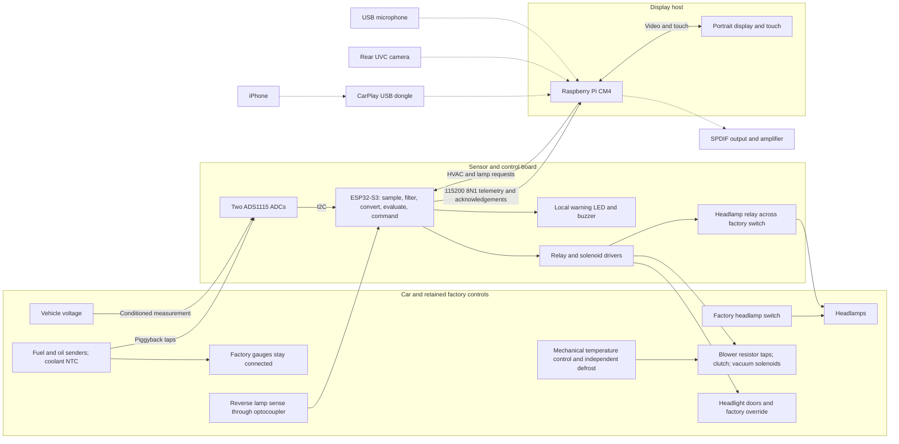

Preserve these contracts through every change:

1. **Warnings remain local.** Acquisition, filtering, conversion, fault evaluation, LED, and
   buzzer run on the MCU with the Pi powered off. Host fault colors are presentation of MCU
   decisions. The mock simulates those decisions only for development.
2. **The factory headlamp path remains authoritative.** The added relay is in parallel.
   Releasing it cannot extinguish lamps held on by the factory switch.
3. **Stale is visible.** At the configured timeout, no greater than 1000 ms, gauges become
   unavailable and show a communications fault. Invalid frames do not refresh that deadline.
4. **Comms loss preserves MCU outputs.** There is no host timeout that switches the blower
   off. This is hold-last-state while the MCU is running, not persistence across MCU reset:
   firmware startup initializes outputs off.
5. **Defrost and temperature control have a physical fallback.** A touchscreen button is
   not the independent fallback required by the specification.
6. **Calibration provenance stays explicit.** Placeholder curves never become measured
   curves merely because data looks plausible.

Relay telemetry reports the MCU's **commanded outputs**, not measured blower speed, clutch
engagement, light output, or door position. In particular, `headlights=false` says nothing
about whether the factory switch has lit the lamps. Auto theme currently follows that relay
field; it is not an ambient-light sensor or independent factory-switch sensor.

The planned power topology is separate from the data path:

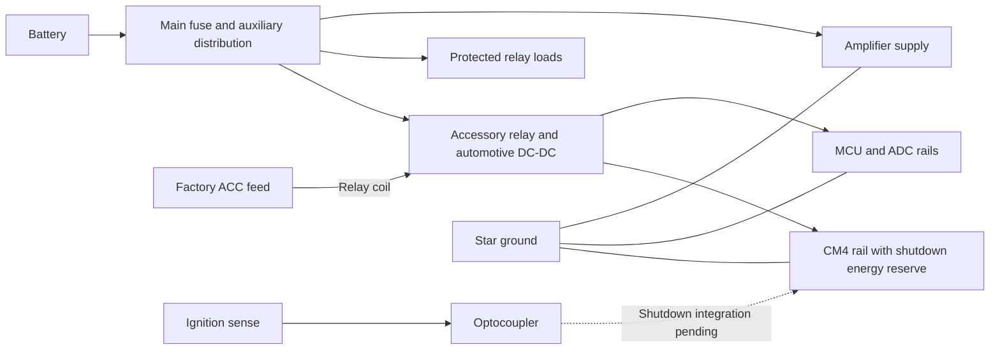

Electrical sizing, protection, grounding, and installation acceptance remain in spec §8 and
§11. No ignition GPIO shutdown handler or complete deployable OS image exists yet.

## 3. Repository and dependency architecture

Most classes are small concrete owners. Abstract interfaces exist where hardware or an
external effect must be replaceable. Value structs carry state between those owners.

| Location | Responsibility and important entry points |
| --- | --- |
| [src/main.cpp](../src/main.cpp) | Composition root: configuration, resources, backend selection, lifetime, exit policy |
| [src/app](../src/app) | `EventLoop`, `TelemetryIngestor`, `BackgroundIo`, `DockController`, `WellController`, config, settings storage, headless runner |
| [src/vehicle](../src/vehicle) | `HvacState`, `LampState`, `RelayState`, validation, command formatting, acknowledgements, `CommandSink` |
| [src/telemetry](../src/telemetry) | `Frame`, source interface/adapters, wire/CSV codecs, freshness, calibration-file loading |
| [src/render](../src/render) | `ConsoleScene`, drawing functions, presentation models, geometry, hit testing, themes, units, icons, fonts |
| [src/platform](../src/platform) | Display/input adapters, coordinate transforms, watchdog, capture interface, GL backend glue |
| [src/audio/audio_state.h](../src/audio/audio_state.h) | Plain audio settings, presets, `AudioSink`; hardware output is pending |
| [src/carplay](../src/carplay) | Placeholder for USB transport, decoder, and touch bridge |
| [src/logging](../src/logging) | Bounded formatting, levels, and replaceable output sink; lower level than app orchestration |
| [src/util](../src/util) | Fixed containers/formatting, clocks, parsing helpers, RAII fd, SPSC queue, triple buffer, shared curve math; no project-layer dependencies |
| [firmware/esp32/src](../firmware/esp32/src) | Arduino hardware integration and ADS1115 driver |
| [firmware/esp32/lib/c3fw](../firmware/esp32/lib/c3fw) | Pure C++ firmware logic compiled into host tests as well as firmware |
| [config](../config) | Startup defaults and explicitly placeholder calibration |
| [tests](../tests) | Catch2 behavior and contract regressions |
| [tools](../tools) | ARM64 container builds, calibration generation, replay instructions |
| [assets/fonts](../assets/fonts) | Inter and Barlow fonts with their licenses |

The following diagram summarizes first-party **CMake link dependencies**, omitting utility
headers, warning flags, and external libraries. It is not a call sequence.

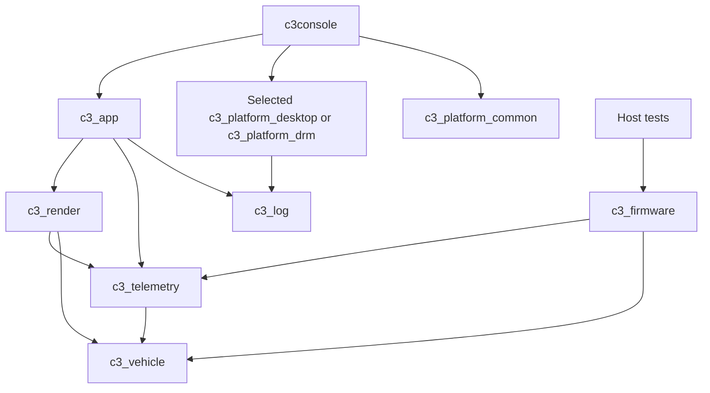

See [CMakeLists.txt](../CMakeLists.txt) for exact linkage. `c3_firmware` makes MCU pure logic
testable on the host; it is **not linked into the console executable**. SDL2 belongs only to
the desktop build. The target uses libdrm, GBM, EGL, GLES2, libinput, and libudev.

### Design patterns already in use

| Pattern | Concrete use | Maintenance consequence |
| --- | --- | --- |
| Ports and adapters / Strategy | `SensorSource`, `DisplayBackend`, `InputSource`, `CommandSink`, `AudioSink`, `Watchdog` | Add a concrete adapter at a real external boundary; keep policy outside it |
| Composition root | `main.cpp` and `run_console()` | Create resources once and inject references; avoid service locators and global controllers |
| Model/controller/view separation | Value models, app controllers, NanoVG drawing | Draw functions neither send UART commands nor persist preferences |
| Explicit state machines | Link, command, gesture, camera/sheet arbitration | Represent pending, unknown, cancellation, and failure explicitly |
| Ordered queue versus latest snapshot | CSV/log queues versus settings/telemetry triple buffers | Choose whether losing intermediate values is allowed before choosing a container |
| Transactional editing | Slider preview, commit on release, rollback on cancel | Intermediate movement must not accidentally become a durable or physical action |
| RAII and result values | File descriptors, display resources, creation/result structs | Cleanup follows ownership; runtime failure propagates without exceptions |

There is no event bus, widget framework, generic controller hierarchy, or separate telemetry
thread today. `WellController` deliberately owns both surface arbitration and sheet editing;
split out an editor only when those policies grow enough to justify another owner.

## 4. Building and running

Start from the repository root. A desktop development machine needs a C++20 toolchain,
CMake 3.25 or newer, SDL2, and OpenGL. NanoVG is a submodule. CMake finds nlohmann/json locally
or fetches the pinned fallback; tests also need Catch2 as configured in
[tests/CMakeLists.txt](../tests/CMakeLists.txt). Inspect the
[container Dockerfile](../tools/docker/Dockerfile) for the maintained Linux package set.

```sh
git submodule update --init --recursive
cmake -B build -DC3_BACKEND=desktop -DCMAKE_BUILD_TYPE=RelWithDebInfo
cmake --build build -j
ctest --test-dir build --output-on-failure
./build/c3console --desktop --source=mock --profile=WarmupDrive
```

Useful development runs:

```sh
./build/c3console --help
./build/c3console --source=mock --headless=5
./build/c3console --desktop --source=mock --open=settings
./build/c3console --desktop --source=mock --open=audio
./build/c3console --desktop --source=mock --open=calibration
./build/c3console --desktop --source=mock --open=camera
./build/c3console --desktop --source=mock --profile=LinkLoss --screenshot=/tmp/c3-stale.ppm --screenshot-after=12
./build/c3console --source=mock --headless=10 --record=/tmp/c3-drive.csv
./build/c3console --desktop --replay=/tmp/c3-drive.csv
```

`--record` **creates/truncates** its destination; use a new filename for each drive. It does
not append despite an older comment in `args.h`. `--headless=0` runs until interrupted.
Screenshots are binary PPM and exit after capture. Normal interactive exit is window close,
Escape, SIGINT, or SIGTERM.

Build Linux ARM64 variants from the Mac using Docker, not a macOS cross-toolchain:

```sh
tools/docker/build.sh drm --tidy
tools/docker/build.sh desktop
```

These scripts build, run CTest, and run a short headless mock smoke check. Their outputs are
`build-drm-docker/` and `build-desktop-docker/`; the DRM smoke check does not initialize KMS.
For an offscreen screenshot after the desktop container build:

```sh
docker run --rm --platform linux/arm64 -v "$PWD":/src -w /src \
  -e SDL_VIDEODRIVER=offscreen c3console-build:bookworm \
  ./build-desktop-docker/c3console --desktop --source=mock --open=settings \
  --screenshot=/src/build-desktop-docker/settings.ppm
```

On a provisioned CM4:

```sh
cmake -B build-pi -DC3_BACKEND=drm -DCMAKE_BUILD_TYPE=Release
cmake --build build-pi -j4
ctest --test-dir build-pi --output-on-failure
```

Build firmware separately with PlatformIO:

```sh
pio run -d firmware/esp32
```

Flashing and wiring follow [phase2-bench.md](phase2-bench.md). The selected platform in
[platformio.ini](../firmware/esp32/platformio.ini) uses pioarduino's moving `stable` URL, so
record the resolved platform/framework/compiler versions with a hardware build. A timestamp
alone is insufficient to reproduce a firmware binary.

## 5. Startup, configuration, and lifetime

The normal startup path in [main.cpp](../src/main.cpp) is:

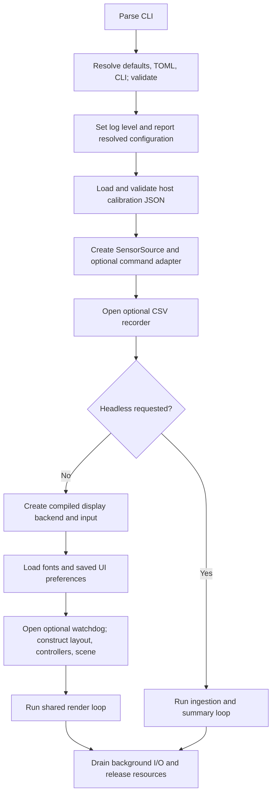

Configuration precedence is `Config` defaults, then `console.toml`, then CLI options, followed
by validation. `ConfigResolution` distinguishes configuration errors from usage errors.
The TOML reader is a deliberate subset: sections, scalar values, and single-line scalar arrays;
it is not a general TOML implementation. Unrecognized keys are currently ignored; check the
resolved startup configuration and add parsing/validation tests when introducing a setting.

| Configuration group | Effect |
| --- | --- |
| `[display]` | Logical geometry, DPI, DRM device, mounting rotation, assets, requested backend |
| `[telemetry]` | Mock/replay/UART selection, UART path/baud, stale timeout, profile, recording/replay paths |
| `[ui]` | Default theme/accent/units and optional persistent settings path |
| `[platform]` | Optional watchdog device |
| `[calibration]` | Host calibration JSON, validated even in mock/headless mode |
| `[logging]` | `debug`, `info`, `warn`, or `error` |
| `[carplay]`, `[audio]` | Configuration for future integrations; these fields do not make those integrations operational |

`--config` explicitly selects a file. Otherwise project paths are searched from the working
directory and then relative to the executable. `find_project_path()` also locates assets and
calibration. Arbitrary recording/settings paths do not acquire a special data-directory meaning;
use absolute deployment paths.

**Display backend selection is compile-time.** `C3_BACKEND=desktop|drm` determines what gets
linked. CLI/config can request a backend, but a mismatch only logs a warning and uses the one
in the binary. Source selection is runtime, so either build can use mock, replay, or UART.

The source factory returns the owning `unique_ptr<SensorSource>` plus borrowed access to its
mock or command capability. UART implements `SensorSource` and `CommandSink` on the **same
descriptor**. Never open a second serial reader for commands; it would compete for telemetry
and acknowledgement bytes.

All controllers, scene models, and input are owned by the startup/render scope. They borrow
dependencies that outlive them. Fonts require a valid NanoVG context and load before the loop.
`BackgroundIo` must finish before its recorder or log-sink context is destroyed. SIGINT and
SIGTERM set an atomic stop flag; signal handlers do not log, write settings, or release graphics.

Exit codes are 0 for normal rendered completion, 1 for configuration failures, 2 for usage,
and 3 for rendered runtime failures. Headless returns 0 if it saw a frame, otherwise 1. A
headless zero exit does **not** assert that the source was still live at shutdown.

## 6. Event loop, threads, and timing

[EventLoop](../src/app/event_loop.cpp) uses portable `poll(2)` and a monotonic deadline.
There is no epoll/timerfd implementation today. The rendered tick period is 16,667 μs, roughly
60 Hz; headless ticks every 100 ms. An overrun never causes an unbounded burst of catch-up
ticks. Descriptor registrations and callback storage are created before entering the loop.

The UART descriptor is registered for readability. Mock and replay are polled on ticks.
Input is drained on ticks; the render loop does not currently register the libinput fd, USB
events, or decoder events. DRM presentation waits inside `end_frame()`.

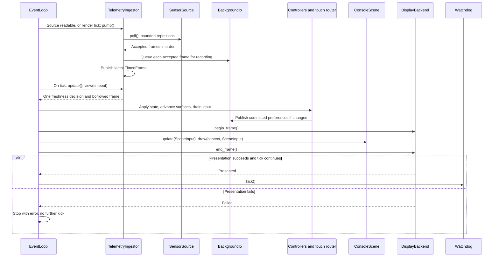

`TelemetryIngestor::pump()` accepts at most 32 frames per call. UART `poll()` processes at
most 1024 buffered/input bytes and returns at most one accepted frame, retaining the rest for
later calls. Input draining handles at most 64 events per render tick. These are per-call work
bounds, not promises about operating-system scheduling or hardware latency.

### Thread and storage ownership

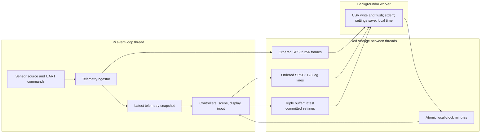

Telemetry ingestion and rendering are currently on the **same thread**. `FrameSnapshot` uses
`util::TripleBuffer<TimedFrame>`, but that does not imply a background telemetry reader.
`BackgroundIo` is the separate host worker. It drains frames/logs, persists the newest settings,
updates local time, and sleeps briefly between passes.

The queue/snapshot distinction matters:

- `SpscQueue` preserves accepted item order. A full queue refuses the new item; dropped frames
  and logs are counted and reported at shutdown. It must have exactly one producer and one
  consumer. Do not publish from a future USB/audio thread into an existing render-owned queue.
- `TripleBuffer` keeps the latest value and may skip intermediate publications. Producer,
  consumer, and exchange slots have distinct ownership, transferred through an atomic index.
  Do not simplify it to two buffers; a producer could otherwise overwrite a buffer being read.
- `TelemetryView::frame` borrows the ingestor's latest storage. Consume it within the current
  update/draw operation. Do not retain it across updates or send that pointer to another thread.
- `log::ScopedSink` redirects logging on the event-loop thread during execution. It is not a
  process-wide guarantee that every future thread's log output is asynchronous.

First-party render and telemetry hot paths use fixed storage, no blocking locks, and no
exceptions. Allocations for configuration, source construction, replay loading, callback
registration, fonts, and worker setup belong at startup. Runtime settings persistence can
allocate and handle exceptions on its worker.

This is not yet a measured allocation guarantee for NanoVG or the GL driver: first-use glyphs,
atlas growth, and geometry caches need target profiling. Screenshot capture deliberately does
synchronous readback/file I/O and is outside production timing expectations.

Frame statistics report CPU work from ingestion through input, model updates, and drawing
before presentation, plus frame duration including presentation. Readable-source callbacks
between ticks are additional work. The spec's sub-8-ms CPU target and 60-Hz presentation are
different measurements; neither average alone establishes worst-case latency.

## 7. Telemetry from bytes to gauges

### The data contract

[Frame](../src/telemetry/frame.h) carries engineering units, raw ADC counts, faults, optional
relay feedback, and reverse. The MCU owns conversion; the host calibration inspector may
compare a local table against raw counts, but does not replace received gauge values.

| Wire key | C++ field | Meaning |
| --- | --- | --- |
| `t` | `t_ms` | MCU milliseconds since boot; 32-bit, not wall time |
| `fuel` | `fuel_fraction` | Fraction 0–1 |
| `oil` | `oil_psi` | Pressure in psi |
| `clt` | `coolant_f` | Temperature in °F |
| `volt` | `voltage_v` | Volts |
| `raw` | `raw` | Four ADC counts in Fuel/Oil/Coolant/Volt order |
| `faults` | Fixed-capacity `faults` | Up to eight known fault codes |
| `relays` | Optional `RelayState` | Blower, AC, mode, headlamp relay, optional door relay |
| `rev` | `reverse` | Reverse-lamp sense, default false if absent |

The current frame type does not retain a separate presence bit for `raw` or `rev`; absent
raw counts default to zero. Do not mistake those defaults for confirmed calibration samples.
Relay absence is explicit and disables vehicle controls.

The wire is newline-delimited JSON, normally 10 Hz, at 115200 baud, 8N1. See spec §4 and
[protocol.h](../src/telemetry/protocol.h) for the exact contract. Telemetry uses its own
fixed-buffer scanner in `protocol.cpp`; flat command/acknowledgement objects use
[flat_json.h](../src/util/flat_json.h). Neither hot path uses nlohmann/json.

- Maximum line length is 512 bytes excluding newline; CRLF is tolerated. An overlong line is
  discarded through its newline so subsequent lines can recover.
- `t`, `fuel`, `oil`, `clt`, `volt`, `faults`, and the final `crc` member are required.
  `raw`, `relays`, and `rev` are optional.
- A present `relays` object must contain `blower`, `ac`, `mode`, and `headlights` once each.
  `doors` is optional. Empty/incomplete objects do not masquerade as confirmed all-off state;
  duplicate relay fields are malformed.
- Finite numeric values must satisfy wire plausibility ranges: fuel 0–1, oil 0–200 psi,
  coolant −40–400 °F, voltage 0–40 V. These are corruption checks, not warning thresholds.
- Unknown object fields can be skipped. Unknown fault codes reject the frame. Adding a new
  fault therefore requires coordinated host/firmware compatibility planning.
- CRC is **CRC-16/CCITT-FALSE**: polynomial `0x1021`, initial value `0xffff`, no reflection,
  no final XOR. The known `123456789` vector is `0x29b1`. Coverage is the exact serialized
  JSON object with the trailing `,"crc":"xxxx"` member removed and the closing `}` included;
  newline is excluded. The final member contains four hex digits. Reformatting the payload
  changes its CRC; do not calculate it from a reparsed/re-serialized object.

`parse_frame()` returns a `ParseResult`, including the error reason. `UartSource` counts valid,
bad-CRC, and malformed frames; it recognizes command acknowledgements separately. It opens
the fd nonblocking, keeps unread bytes from each read, and treats terminal I/O failure as
`Failed`. There is no automatic reopen/reconnect loop today.

### Freshness uses host receive time

Each accepted frame gets a **host monotonic receive timestamp**. This avoids comparing the
MCU's boot clock with the host clock. Do not use local time, `Frame::t_ms`, or the most recent
byte arrival as the live-data deadline.

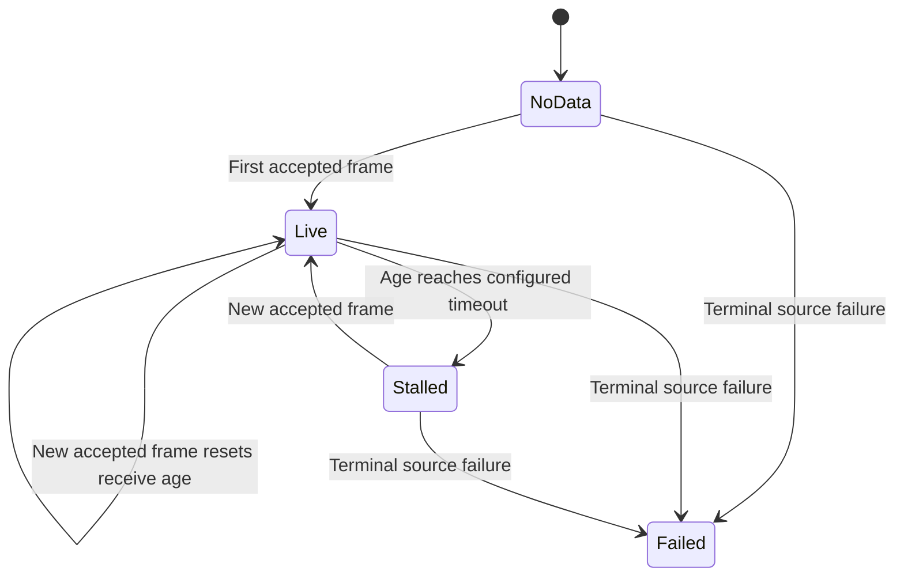

[freshness.h](../src/telemetry/freshness.h) is shared policy: live means age **strictly less
than** the timeout, capped at 1000 ms. `Failed` overrides age immediately. A malformed frame
never republishes a snapshot. The rendered loop shares one `TelemetryView` across gauges,
well, and controls. Headless currently asks the ingestor for a fixed 1000-ms timeout; it does
not propagate a smaller configured render timeout into that view.

This detects silence since **host acceptance**, not absolute sensor acquisition age. The
wire has no synchronized age or sequence contract that can prove an old queued frame is fresh
at the sensor. Keep transport backlogs bounded and include that distinction in latency tests.

### Source behavior and recording

| Source | Timing and storage | Controls and limitations |
| --- | --- | --- |
| `MockSource` | Injectable monotonic clock, deterministic 100-ms physics steps, at most 50 catch-up steps per poll | Mock sink changes loads; next frame echoes outputs. Poll returns the latest model frame, not every catch-up step |
| `ReplaySource` | Reads CSV into memory at initialization, returns due rows using MCU timestamp deltas; gaps cap at 10 s | EOF becomes `Failed`; malformed rows are counted/skipped; no relay/reverse reproduction or commands |
| `UartSource` | Nonblocking byte stream, ordered valid frames, health counters and bounded work | Owns command transmission/ACK/confirmation; no automatic reconnection |

Mock profiles are `ColdStart`, `WarmupDrive`, `HotIdle`, `HighwayCruise`, `OilPressureLoss`,
`Overheat`, `SenderOpen`, `AlternatorFail`, and `LinkLoss`. `LinkLoss` emits normally for ten
seconds and then goes silent. The model is repeatable for a given clock, profile, and loads;
it is not a calibrated engine or a substitute for sensor/relay hardware.

The ingestion callback queues every accepted frame **before** publishing the latest snapshot,
so rendering can skip intermediate frames without silently reducing the recorded stream.
Queue overflow is still possible and counted. The CSV schema is:

```text
timestamp_ms,fuel_raw,oil_raw,clt_raw,volt_raw,fuel,oil,clt,volt,faults
```

Fault codes are separated by `|`, fields are unquoted, and relay/reverse/host-receive-time
fields are absent. Backward timestamps are replayed without a negative delay; the format does
not distinguish MCU restart from clock wrap. Replay cannot reconstruct every original timing
or UI state. See [csv_codec.h](../src/telemetry/csv_codec.h) and
[replay instructions](../tools/replay/README.md).

## 8. Vehicle commands and confirmation

[vehicle/command.h](../src/vehicle/command.h) separates **submission outcome** from **eventual
command status**. `Accepted` means the transport accepted work; it does not mean hardware
changed. `Busy`, `Unavailable`, and `Invalid` reject submission immediately.

`DockController` builds a desired state from the latest reported state. It does not optimistically
overwrite that state. A valid HVAC state has blower 0–4, a supported mode, and no AC with
blower zero. Selecting blower off also requests AC off. The MCU independently validates the
whole command before touching outputs.

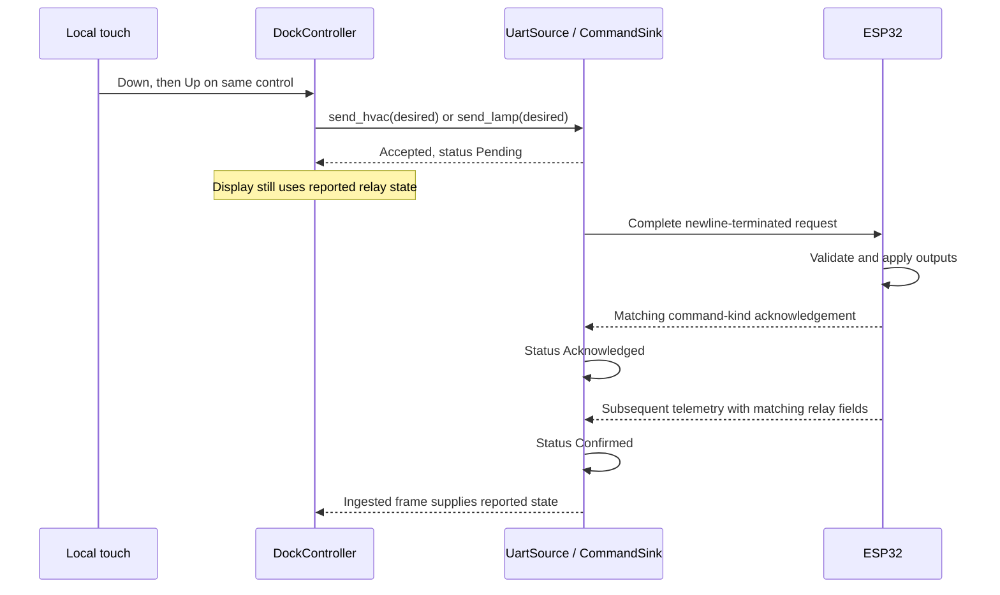

Representative command lines, without any invented telemetry checksum:

```json
{"cmd":"hvac","blower":2,"ac":true,"mode":"vent"}
{"cmd":"lamp","headlights":true,"doors":false}
```

UART permits **one outstanding command total**, across HVAC and lamps. It stores the line in
a fixed buffer and advances partial writes during `poll()`, handling temporary backpressure.
An ACK is considered only for the pending kind after transmission completes. A negative ACK
becomes `Rejected`; a positive ACK becomes `Acknowledged`. Confirmation requires a **later**
matching relay frame. A matching frame seen before the ACK does not finish the request.

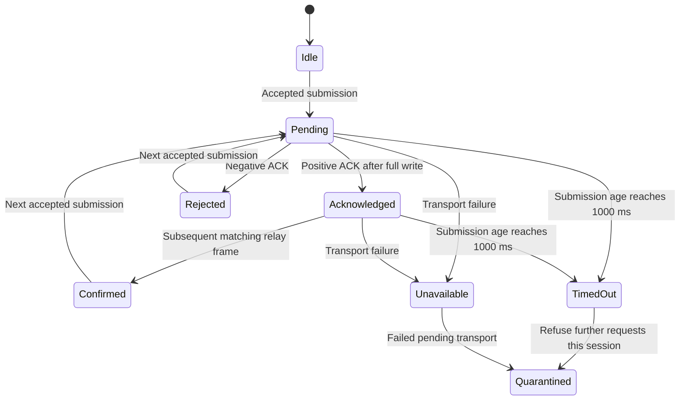

There are no transaction IDs. After a timeout or failed pending transport the command session
is quarantined until the source is recreated, currently by process restart. Otherwise a late
ACK could be mistaken for a later request. Do not add automatic retries or clear quarantine
on a new telemetry frame without first designing an unambiguous protocol recovery contract.

Missing relay feedback disables the dock. Missing `doors` feedback disables **both** lamp
buttons: the host sends a complete lamp state and must not overwrite an unknown door state.
Lamp confirmation also requires door feedback. Stale telemetry disables interaction while
the MCU holds outputs independently.

Mock submission updates model loads and reports `Confirmed` immediately through
`MockCommandSink::status()`; visible values still come from subsequent mock telemetry. It does
not simulate UART backpressure, ACK timing, refusal, or timeout. Those paths need transport
tests. Replay's null mock sink reports `Unavailable`.

## 9. Firmware acquisition, warnings, and calibration

### Hardware shell and pure logic

[firmware/esp32/src/main.cpp](../firmware/esp32/src/main.cpp) is the hardware shell. It wires
Arduino `Wire`, UART1, GPIO, and `Preferences` to pure logic in
[c3fw](../firmware/esp32/lib/c3fw/src/c3fw). Keep hardware APIs out of that pure library so
faults, filters, commands, and codecs remain executable under host Catch2 tests.

[pins.h](../firmware/esp32/include/pins.h) is explicitly provisional. Current ADC assignment:

| ADS1115 | Input | Channel |
| --- | --- | --- |
| `0x48` | A0–A1 differential | Fuel |
| `0x48` | A2–A3 differential | Oil |
| `0x49` | A0–A1 differential | Coolant |
| `0x49` | A2 single-ended, conditioned input | Voltage |

Two ADCs are necessary: one ADS1115 offers two differential pairs, not four. The boards share
I²C and conversions on separate chips run in parallel. UART1 is the Pi link; USB/debug Serial
carries startup diagnostics, not telemetry.

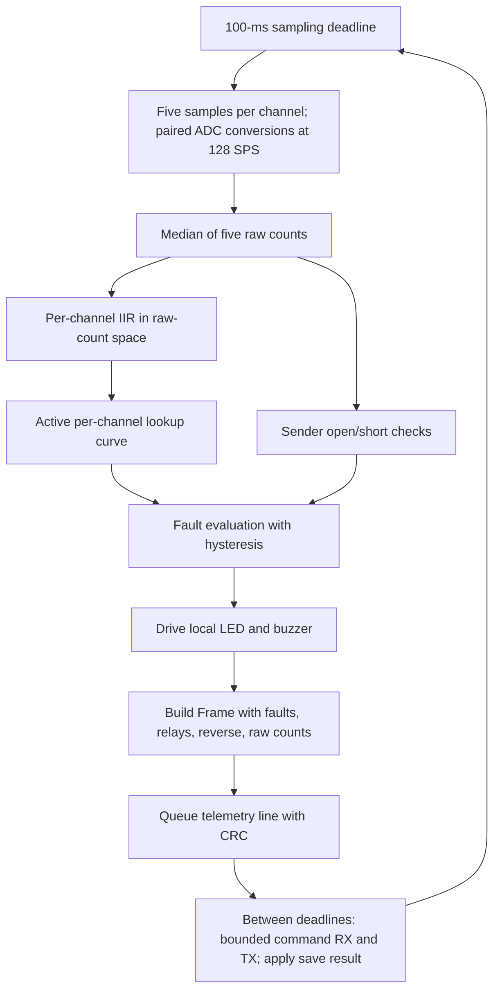

Median sampling nominally occupies about 90 ms at the current conversion waits. I²C overhead,
readiness waits, and flash stalls can extend that; **100 ms is a schedule, not a measured
worst-case guarantee**. Sampling is checked before command work and uses bounded catch-up.

The raw counts in `Frame::raw` are the median counts, before the IIR. The converted fields use
IIR-filtered counts. Consequently the calibration inspector's conversion of a raw sample may
differ transiently from the MCU field even with identical tables.

| Channel | IIR time constant | Reason to keep it distinct |
| --- | --- | --- |
| Fuel | 10 s | Suppress tank slosh |
| Coolant | 2 s | Slow thermal signal |
| Oil | 0.2 s | Preserve rapid pressure-loss visibility |
| Voltage | 0.5 s | Smooth electrical variation |

Filtering occurs **before** nonlinear conversion. Sender checks use the unfiltered median
counts. Current windows treat near-full-scale fuel/oil/coolant as open, and near-zero coolant
as short; fuel and oil can legitimately approach zero resistance. Windows are hypotheses
pending bench measurement. An ADC bus failure marks all channels open instead of reusing a
frozen measurement.

### Warning evaluation

[faults.h](../firmware/esp32/lib/c3fw/src/c3fw/faults.h) owns hysteresis. A sender fault suppresses
that channel's value fault because its value is not meaningful.

| Fault | Set | Clear |
| --- | --- | --- |
| `OIL_LOW` | Oil < 12 psi | Oil ≥ 15 psi |
| `CLT_HIGH` | Coolant > 235 °F | Coolant ≤ 228 °F |
| `FUEL_LOW` | Fuel < 0.08 | Fuel ≥ 0.10 |
| `VOLT_LOW` | Voltage < 12.4 V | Voltage ≥ 12.8 V |
| `VOLT_HIGH` | Voltage > 15.2 V | Voltage ≤ 14.9 V |

The LED is on for oil-low or coolant-high. The buzzer is on for coolant-high, or oil-low with
a valid voltage reading ≥13.2 V, used as a charging/engine-running proxy. It is not an RPM
measurement. Sender faults themselves do not currently drive this LED/buzzer rule. Test the
actual policy rather than assuming every displayed fault sounds a warning.

GPIO warning outputs are updated before the frame is queued. Transmit progress and Pi
acknowledgements never gate warning evaluation. Serial receive processes at most 64 bytes
between deadline checks; transmit writes at most 64 bytes already allowed by UART capacity.
An eight-line fixed queue drops on overload. Avoid stream APIs that wait for a whole command
or perform blocking runtime debug prints on this task.

Relays are one-hot for blower speeds 1–4, all-off for speed zero, and switch break-before-make.
Vent releases both mode solenoids; floor and defrost each select one. AC with blower off is
rejected. The exact pins, active polarity, physical relay release time, and fallback operation
must still be validated on the real board.

### Calibration has two separate stores

The **host JSON** powers startup validation and the calibration inspector. The **MCU active
curves** perform real conversion and use compiled placeholder defaults or measured per-channel
NVS overrides. Editing the host JSON does not upload a curve to the MCU, and saving an MCU
curve does not update the host file. There is no automatic synchronization or wire-level
calibration-provenance report today; the inspector's placeholder banner describes its host
table, not proof of the MCU's active provenance.

[util/linear_curve.h](../src/util/linear_curve.h) supplies fixed-capacity interpolation and
linear extrapolation at both ends. Curves have at most 24 strictly ordered raw points and
finite values. The host requires at least two points, and at least eight **per channel** if
the file claims `placeholder=false`.

[tools/generate_calibration.py](../tools/generate_calibration.py) generates the MCU placeholder
[lookup.h](../firmware/esp32/lib/c3fw/src/c3fw/lookup.h) from the shipped JSON. Run it when those
defaults deliberately change; do not hand-edit generated curve values. The generator is for
placeholder defaults, not an alternative measured-calibration upload procedure. A host test
checks that firmware defaults and the JSON agree.

MCU calibration commands use a transaction across RAM staging and NVS:

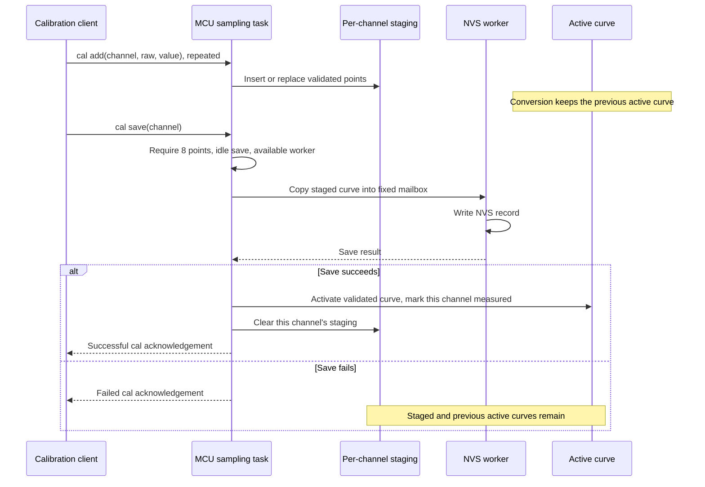

`cal add` does not clear placeholder provenance. Only successful activation does. While a save
is pending, further calibration changes are refused. On boot, NVS records are validated for
size, point count, ordering, and finite values before per-channel activation; invalid records
leave that channel on its placeholder default.

The MCU uses fixed-storage FreeRTOS mailboxes with zero queue wait for save requests/results.
They use short critical sections because this ESP32 toolchain does not guarantee lock-free
atomics. Do not describe them as the same lock-free primitive as the Pi SPSC queue. Moving
NVS work to a task does not prove flash/cache stalls cannot delay sampling; measure that on
the rig. NVS currently stores raw point structs under `c3cal` keys `fuel`, `oil`, `clt`, `volt`;
there is no versioned migration layer. Changing point layout requires an explicit storage plan.

## 10. Rendering, surfaces, and touch

### Scene and geometry

[ConsoleScene](../src/render/console_scene.h) composes the status bar and its theme button, the tab bar, gauges, the Systems card, the central well,
the dock, and the retained-control hint. `SceneInput` is the complete view for one frame:
telemetry/freshness, confirmed dock model, clock, elapsed time, units, and `WellView`.
`update()` advances needle damping; `draw()` renders the prepared state using NanoVG.

The panel is **800 × 1280**; the reference layout is drawn at 2× (**1600 × 2560**) with a
**1520 × 1392** well on top, a tab bar under it, the cluster and two dock islands below
(v6 mockup, `docs/c3-console-ui-design.md`). Layout is proportional and the well dimensions
snap to multiples of 16 for eventual video negotiation. Use
[Layout](../src/render/layout.h), `DockLayout`, `TabsLayout`, `ToolsLayout`, `SheetLayout`
(one per settings `Page`), and `CameraLayout` as the shared source of drawing and hit-test
geometry. Do not duplicate a
button's coordinates in its controller.

Desktop `Viewport` accounts for window size, drawable/HiDPI size, and letterboxing. DRM
rotation maps native scanout to logical panel pixels; input applies the inverse transform.
Controllers and scene code operate in logical panel pixels, and CarPlay receives well-local
coordinates. Keep these coordinate spaces explicit when adding code.

Gauge classification is `Ok`, `Warn`, `SenderFault`, or `Stale`, derived from fault codes and
the shared live flag. Alerts map those codes into severity and display text. Numeric warning
decisions must not be added to drawing functions. Needle animation is cosmetic damping,
separate from the MCU filter; displayed numerals use received engineering values. Unit
conversion to °C or bar is presentation-only; wire, CSV, and calibration retain °F and psi.

Themes are token sets with a selected accent and contrast ink. Fonts load at initialization.
Reuse [widgets](../src/render/widgets.h), [icons](../src/render/icons.h), and theme tokens to
keep controls consistent. The browser mockup is a design reference, not a runtime web view.

Scenes draw through [draw.h](../src/render/draw.h), not NanoVG directly: fills, hairlines,
arcs, ticks, paints, text, and a `draw::State` guard for transform, clip and alpha changes.
The backend's types are named once in [canvas.h](../src/render/canvas.h) as `Canvas`,
`Color` and `Paint`. Raw `nvg*` calls are confined to `draw.h`, the icon and brand path data,
font loading, the colour constructors in `theme.cpp`, and the platform backends that create
the context. `platform/display_backend.h` keeps `NVGcontext*` in its interface on purpose
(AGENTS.md); do not wrap that seam. Strokes take their cap explicitly, so no helper depends
on what the previous caller left in the canvas state.

### The well is an arbitrated surface

`WellController` owns which surface occupies the central rectangle:

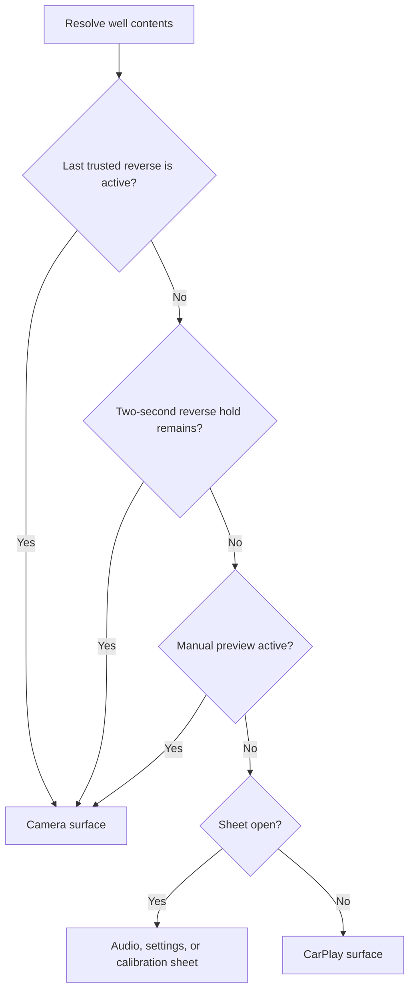

Live reverse entry closes the open sheet and clears manual preview. A live transition out of
reverse starts a two-second hold. During reverse/hold, opening a sheet is blocked. Stale
telemetry preserves the last trusted reverse/headlamp states rather than inventing a new
gear or lamp condition. Thus a reverse-active surface can remain selected through a link loss.
Actual camera video is not implemented; the current surface says unavailable. Likewise the
loop currently passes `carplay_connected=false`.

### Gesture ownership and cancellation

Input backends normalize to `TouchEvent { phase, x, y, id }`, with `Down`, `Move`, `Up`, and
`Cancel`. They track one contact independently of their event queue. Additional contacts do
not steal the active contact. libinput release events may omit coordinates, so the backend
retains the last position. Queue overflow or device/focus cancellation must not synthesize
an activating release.

[TouchRouter](../src/render/touch_routing.h) chooses UI or CarPlay on **Down** and holds that
ownership through the gesture. The well uses half-open boundaries: left/top included,
right/bottom excluded. Crossing a boundary does not transfer ownership. CarPlay-owned motion
is clamped to well-local bounds. The future bridge must preserve the entire gesture, including
cancellation; today the forwarding seam only logs events.

When the well's surface identity changes, the router cancels the old recipient and ignores
the orphaned release. The loop delivers local cancellation to both controllers so no dock
press or sheet drag survives a camera takeover. A plain button activates only when release
hits its original control. Sliders preview during movement, commit on release, and restore
their pre-drag values on cancellation.

These rules need behavior tests. A screenshot cannot show that a release after queue drain,
surface takeover, or dragging outside the well was routed correctly.

## 11. Settings, audio state, and persistence

[render::Settings](../src/render/settings.h) contains theme preference, accent RGB, and
temperature/pressure units. Startup overlays the optional settings file on `console.toml`
UI defaults. Missing or corrupt settings fall back to those defaults and are logged; a corrupt
file is left available for inspection. An invalid required calibration JSON is different:
startup currently fails.

`WellController::take_theme_change()` publishes in-memory visual changes, including hue
previews. `take_settings_change()` publishes committed preferences only. The render loop hands
that value to `BackgroundIo` if a settings path is configured. An empty path means session-only
preferences. The status-bar theme toggle chooses an explicit dark/light preference, leaving
Auto; Auto follows trusted headlamp relay feedback.

[settings_store.cpp](../src/app/settings_store.cpp) writes a temporary file, flushes it to
storage with `fsync`, renames it, and fsyncs the containing directory. This avoids leaving a
partially rewritten settings file. The parent directory must already exist and be writable.
Pending saves coalesce to the latest value, so not every rapid commit becomes a disk write.
The UI does not wait for a durable-save acknowledgement. Power loss can lose a change still
in memory or queued for persistence.

CSV recording uses worker-side writes and `fflush`; that is not a per-record `fsync`
guarantee. Log and record queues can drop new entries under overload. Shutdown stops producers,
restores the previous log sink, and joins/drains the worker before inspecting recorder counters.
A blocked filesystem can still delay shutdown even though it does not block normal rendering.

[AudioState](../src/audio/audio_state.h) contains volume/mute, balance/fader, sub level, tone,
and preset selection. It belongs to the Pi, not the MCU protocol. `LogAudioSink` is the only
implementation today. Audio slider movement previews state; committing calls the sink.
Audio state is not part of the current persisted `Settings` file. Adding real DSP or durable
audio settings requires explicit output and persistence behavior, not just drawing a control.

## 12. Display failure, shutdown, and deployment

[DisplayBackend](../src/platform/display_backend.h) exposes size/DPI, an initialization context,
`begin_frame()`, and `end_frame() -> PresentResult`. A null begin context or failed presentation
stops the rendered loop with a runtime error. Controllers do not own SDL, EGL, GBM, or DRM
handles.

Desktop creates an SDL OpenGL context with NanoVG GL3. Its swap API does not prove physical
scanout success. Target creates a GBM surface and EGL GLES2 context, then uses legacy KMS
`SetCrtc` for the first frame and page flips thereafter. This is not the future DRM atomic
multi-plane compositor.

DRM framebuffer metadata uses a fixed cache. Page-flip wait has a bounded timeout (100 ms by
default). After a timeout, either old or new buffer may still be scanned out: both stay owned
until restoring the original CRTC or detaching scanout succeeds. If teardown cannot detach,
the process exits immediately with buffers retained for kernel cleanup. Releasing uncertain
buffers for reuse would be a correctness bug. Test this on native DRM; a successful container
compile cannot validate it.

The optional [FileWatchdog](../src/platform/file_watchdog.cpp) receives a kick only after a
successful continuing tick. Normal rendered shutdown permits magic close; presentation
failure does not permit it or issue another kick. Failure to open the configured watchdog
currently logs an error and continues without one. Headless does not open/kick the render
watchdog. Hardware driver, timeout, and systemd behavior remain deployment acceptance items.

The intended target deployment is Bookworm Lite ARM64 on CM4/eMMC, no desktop compositor,
read-only root with overlayfs, volatile journald, no swap, and a small writable `/data`.
Settings should point to `/data/settings.toml`; recordings need an explicitly writable data
destination with a retention policy. The current application does not rotate recordings or
manage free space. Do not enable a long-running recording on tmpfs without budgeting capacity.

The OS-image recipe, service/udev rules, ignition-off shutdown, data mounting, and power-hold
integration remain work in [milestones.md](milestones.md). A deployable release must include
the executable, assets, console configuration, calibration file, firmware build identity,
resolved dependency versions, and wiring/calibration provenance. The shipped defaults select
mock telemetry, disable persistent settings, and disable the watchdog: they are development
defaults, not an installation configuration.

## 13. Adding features

### Add a local setting or sheet control

Use an existing control of the same kind as the pattern. The hue slider is the reference for
preview/commit/cancel; the temperature selector is a small persisted choice.

1. Add the plain value to [Settings](../src/render/settings.h) if it is a persistent visual
   preference, or to the appropriate domain model if it is not. Define defaults and bounds.
2. Add the control identifier in [sheet.h](../src/render/sheet.h). Add its rectangle in
   `SheetLayout::compute()` and drawing in [sheet.cpp](../src/render/sheet.cpp), reading that
   same rectangle. Add an `is_slider()` case only for continuous controls.
3. Handle intent in [WellController](../src/app/well_controller.cpp), preserving button
   release semantics and slider rollback. Publish theme/settings changes through the existing
   take methods. Do not write files or call hardware from the draw function.
4. If persisted, extend startup config parsing/validation, `settings_store`, and
   [console.toml](../config/console.toml). Ensure an older saved file lacking the new key uses
   a sensible default. A new field must remain suitable for fixed-size snapshot copying.
5. Test geometry/hit boundaries, state transitions, defaults/load/save, and cancel versus
   commit. Render light/dark and non-reference panel sizes; verify LinkLoss still wins over
   any new data display.

For a new whole sheet, update `Sheet`, the controller and scene's sheet-layout arrays, surface
selection, and CLI `--open` validation if exposed. Today those arrays have four entries and
`render_loop.cpp` uses numeric surface ID `4` for camera. A fifth sheet must not collide with
that ID. Replace or extend the identification scheme deliberately, with takeover tests.

Several segmented groups rely on contiguous enum values and arithmetic indexing (blower
speeds, modes, presets, swatches, units). Review all indexing when inserting an enum member;
compilation alone will not prove that its label, hit target, and action still agree.

### Add a vehicle control

Start with the physical ownership, feedback, and failure behavior in the specification. A
new lamp/HVAC action has real actuator consequences even if the first demo uses a mock.

1. Define desired and reported state in [vehicle/state.h](../src/vehicle/state.h), keeping
   unknown feedback representable. Decide whether confirmation is commanded-output feedback
   or an actual sensed result.
2. Extend command formatting/validation and the MCU command parser/relay mapping together.
   Specify bounds, rejection, interlocks, defaults, reset behavior, and hold-on-loss behavior.
   Recheck wire line capacities and backward compatibility.
3. Extend `CommandSink`, UART submission/ACK/confirmation, and mock handling as needed.
   Preserve single-command ownership and timeout quarantine unless an approved protocol
   redesign supplies transaction identity and recovery.
4. Add the dock identifier, shared layout, drawing, and controller action. Derive selection
   from feedback, and keep pending/refused/unavailable visibly distinct.
5. Test invalid/partial commands, ACK kind, rejected ACK, delayed ACK, pre-ACK state, missing
   feedback, timeout, and stale UI. Then run the physical fallback and actuator acceptance
   tests. Do not infer hardware success from mock feedback.

### Add a sensor or fault

Trace the change through the whole chain: wiring and ADC scheduling; channel enumeration and
fixed array sizes; median/filter constants; sender windows; active/staged curves and generated
defaults; fault evaluation; frame writer; host parser/limits/fault-code mappings; CSV schema;
mock/replay behavior; gauge/alerts/calibration inspector; tests and the spec.

Choose canonical engineering units once. Keep warning thresholds and local warning output on
the MCU, with hysteresis and invalid-sender behavior specified. A new fault code breaks older
host parsers unless rollout is coordinated. A new CSV column needs a version/compatibility
decision. Check the 512-byte line and eight-fault capacities at worst-case content. An extra
ADC channel also changes the sampling time budget; a new enum is not proof it fits in 100 ms.

### Add a source or platform adapter

Implement `SensorSource::poll()` as bounded, nonblocking, allocation-free runtime work,
`health()` as a cheap truthful snapshot, and `descriptor()` only if readiness is useful.
Then extend source parsing/config validation and [sensor_source_factory](../src/app/sensor_source_factory.cpp).
Inject a monotonic clock for reproducible timeout tests. Test burst ordering, no-data,
malformed input, terminal failure, and freshness. Do not return fabricated last-known data as
new frames to keep the link green.

A display adapter owns its graphics resources and presents the same logical scene. Honor
the `PresentResult` contract and the matching input transform. Keep backend libraries out of
unrelated builds. A new worker/thread requires an ownership and queue-overflow policy; it
must not gain direct access to controller or NanoVG state.

### Implement the remaining media integrations

CarPlay starts with the unmodified reference implementation and the actual dongle, as required
by the spec. Do not invent USB message framing. Confirm vendor/product enumeration against
hardware; both configured product IDs must remain supported. Negotiate the computed well
dimensions, then add V4L2 M2M decode to DMA-BUF, EGLImage import, and a texture in the well.
RAII owners must make buffer/texture/fence lifetimes explicit. Keep negotiation/reconnection
from delaying gauge startup. Add the touch bridge at the existing captured-gesture seam.
DRM atomic planes are deferred until this stage runs in the car.

For audio, implement `AudioSink` and define where DSP, output, microphone, and encoder work
run without blocking rendering. For camera, add a capture/texture adapter under the existing
surface arbitration and specify video freshness separately from telemetry freshness. A live
reverse flag does not prove the camera frame is live. Both features need unavailable/recovery
states, desktop development behavior, and hardware acceptance.

## 14. Tests and maintenance workflow

Tests are named for their contract; start with the ones nearest the changed behavior:

| Contract | Tests to read or extend |
| --- | --- |
| Wire, CRC, UART ordering and commands | [test_protocol.cpp](../tests/test_protocol.cpp), [test_crc16.cpp](../tests/test_crc16.cpp), [test_uart_source.cpp](../tests/test_uart_source.cpp), [test_vehicle_command.cpp](../tests/test_vehicle_command.cpp) |
| Cross-layer runtime, concurrency, cancellation | [test_runtime_contracts.cpp](../tests/test_runtime_contracts.cpp), [test_triple_buffer.cpp](../tests/test_triple_buffer.cpp), [test_event_loop.cpp](../tests/test_event_loop.cpp) |
| MCU logic and host compatibility | [test_firmware_codec.cpp](../tests/test_firmware_codec.cpp), [test_firmware_faults.cpp](../tests/test_firmware_faults.cpp), [test_firmware_filters.cpp](../tests/test_firmware_filters.cpp), [test_calibration.cpp](../tests/test_calibration.cpp) |
| Geometry and coordinate spaces | [test_layout.cpp](../tests/test_layout.cpp), [test_sheet.cpp](../tests/test_sheet.cpp), [test_rotation.cpp](../tests/test_rotation.cpp), [test_viewport.cpp](../tests/test_viewport.cpp), [test_touch_routing.cpp](../tests/test_touch_routing.cpp) |
| UI policy and display interpretation | [test_dock_controller.cpp](../tests/test_dock_controller.cpp), [test_well_controller.cpp](../tests/test_well_controller.cpp), [test_console_scene.cpp](../tests/test_console_scene.cpp), [test_alerts.cpp](../tests/test_alerts.cpp) |
| Recording, replay, persistence, watchdog | [test_csv_codec.cpp](../tests/test_csv_codec.cpp), [test_csv_recorder.cpp](../tests/test_csv_recorder.cpp), [test_replay_source.cpp](../tests/test_replay_source.cpp), [test_settings_store.cpp](../tests/test_settings_store.cpp), [test_file_watchdog.cpp](../tests/test_file_watchdog.cpp) |

Pure behavior needs tests, particularly exact boundaries, missing external input, recovery,
and failure. Avoid tests that merely reproduce implementation expressions. A fake clock
should make the 999/1000-ms stale boundary and command timeout deterministic. PTY-based UART
tests exercise the real byte parser/transport without claiming to be the physical board.

Before completing a code milestone:

1. Run the relevant local tests, then the full desktop build/CTest suite. Format changed C++
   with the repository `.clang-format` and inspect `git diff --check`.
2. Follow the repository's [cpp-review checklist](../.claude/skills/cpp-review/SKILL.md),
   including the ARM64 GCC build and clang-tidy. Build firmware when shared or MCU code changes.
3. Inspect rendered states appropriate to the feature: normal, warning, sender fault, stale,
   pending/unknown controls, dark/light, and affected sheets. Exercise gesture behavior with
   tests; screenshots alone are insufficient.
4. Record commands, actual results, toolchains, and untested hardware requirements. Update
   the spec, milestones, and this guide where contracts changed. Keep commits small and scoped.

The earlier [hardening report](architecture-hardening.md) records 204 tests on each host
variant and a firmware build. That is a dated baseline, not an assertion that a new change
has passed. Do not copy its counts into a new validation report without running the checks.

Hardware acceptance remains spec §11: independent warnings with the Pi off; sender noise and
faults; calibration; relay fallback; UART flood/blocked TX; NVS/I²C timing; actual touch;
DRM timeout/unplug; watchdog reboot; power cuts; boot/frame timing; sun/heat; and key-off draw.
Do not tick those boxes based on host tests.

### Coding and ownership rules

- Keep C++20, `snake_case` files/functions/variables, `PascalCase` types, and `kConstantCase`
  constants. Unit suffixes such as `_ms`, `_psi`, `_f`, `_v`, and `_fraction` disambiguate values.
- Put external effects behind the existing narrow interfaces; use plain structs for state
  and pure functions for transforms/validation. Avoid introducing a dependency for one helper.
- Keep `util` independent of app/render/telemetry. Keep logger below app. Never include
  hardware-shell headers in portable firmware logic.
- Use RAII for every C resource. Treat borrowed pointers/spans/views as scoped, and document
  non-obvious lifetime or thread ownership where the type cannot express it.
- Validate external data with results and reasons. Do not use assertions for malformed UART,
  files, or hardware input. Keep exceptions in startup or explicitly isolated background work.
- Check fixed-buffer capacity and overflow results. A growing feature can invalidate an old
  size assumption even if today's happy-path test passes.
- Comments should explain **why**: CRC coverage, hold-last-state, buffer ownership after a
  flip timeout, ordering after ACK, independent warning timing, or a calibration constraint.
  Names and small functions should explain ordinary mechanics. Remove comments made false
  by a change rather than preserving them as history.

## 15. Troubleshooting and open decisions

Start with the resolved configuration and source type. Then distinguish unavailable data,
transport failure, presentation failure, and a real MCU-reported fault.

| Symptom | Inspect first | Interpretation or next check |
| --- | --- | --- |
| Startup exits before a window | Exit code, config log, calibration path, assets/fonts | Invalid calibration is fatal even for mock; missing fonts prevent rendering |
| Wrong display backend | CMake cache and startup mismatch warning | Runtime flags cannot swap the backend linked into this binary |
| Grey gauges / comms banner | `TelemetryView` age/link; headless source summary; UART path and counters | Check valid frames, not just arriving bytes. Replay EOF and LinkLoss intentionally produce this |
| CRC errors | UART baud/wiring, exact CRC byte coverage, frame writer/parser tests | Never relax CRC validation to hide a transport problem |
| Malformed frames after firmware update | Required fields, fault-code additions, numeric limits, line length | Unknown fault codes and incomplete relay objects reject frames |
| Dock unknown or lamp buttons inert | Live flag, presence of `relays`, presence of `doors` | Older or incomplete feedback is not enough to send a full-state lamp request |
| SENDING / WAITING FOR STATE / NO CONFIRMATION | Partial write, matching ACK kind, subsequent relay echo, timeout | ACK alone is insufficient. Timeout quarantines the session; investigate before restarting |
| Settings disappear on restart | Nonempty `settings_file`, writable parent, worker save errors | Preview is not commit; empty path is in-memory only; unpersisted changes can be lost |
| Calibration inspector and MCU differ | Host JSON versus MCU NVS; raw median versus filtered conversion | Files are not synchronized; current wire does not report active-curve provenance |
| Extra/misdirected touch | Viewport/rotation, contact ID, captured recipient, cancel handling | Reproduce boundary crossing and takeover in tests; avoid per-event re-routing |
| Camera or CarPlay unavailable; no sound | Implementation-status table | These hardware/media integrations remain pending |
| Frame stalls | CPU versus presentation timing, synchronous I/O, GL first-use growth, DRM wait | Screenshot mode is intentionally slow; measure target worst cases |
| Recording has missing frames | Queue-overflow report, recorder write errors, storage speed | Queue acceptance is bounded; CSV lacks relay/reverse and does not fsync every row |
| Watchdog does not reboot | Open warning, deployment config, driver/service setup | It is off by default, absent in headless, and not yet accepted on hardware |

### Known discrepancies and decisions to resolve

These are explicit handoff issues, not permissions to weaken the current safeguards:

| Issue | Current implementation / evidence | Required follow-up |
| --- | --- | --- |
| Voltage calibration point count | Spec §9.2 says two-point voltage measurement, but its later file-format rule and host/MCU validation require eight points for measured curves | Resolve the specification and validation policy before a measured voltage save; do not invent extra measurements |
| Missing calibration fallback | Spec §5.6 discusses future data-file fallback broadly; `main.cpp` currently rejects missing/invalid required calibration JSON, while settings fall back | Specify shipped-versus-user calibration lookup and provenance before adding `/data/calibration.json` |
| Historic names and architecture shorthand | Older text mentions a 1973 L82, absent mockup filenames, epoll, or runtime-selectable display backends | Current vehicle identity is 1975 with engine unconfirmed; implementation uses `poll` and a compiled backend. Keep remaining prose aligned as it is revised |
| Host headless timeout | Render uses configured timeout; headless ingestor view uses 1000 ms | Decide whether diagnostics should mirror a shorter configured deadline and add a boundary regression when changing it |
| Acquisition age versus receipt age | Host freshness timestamps accepted frames; MCU time is unsynchronized | Measure backlog latency; specify age/sequence semantics if stronger freshness proof is required |
| Command recovery | No transaction IDs; timeout requires recreating the source | Design/version coordinated recovery before adding retries or automatic reconnect |
| Calibration durability/provenance | MCU NVS has unversioned point records; host JSON is separate; provenance is startup diagnostics | Plan storage migration and a truthful host/MCU calibration workflow |
| Runtime guarantees | First-party work is bounded; NanoVG/driver allocations and NVS/I²C delays remain unmeasured | Profile on target and complete spec §11 before claiming timing or allocation guarantees |
| Deployment reproducibility | Firmware platform URL tracks `stable`; OS image and hardware acceptance are pending | Capture exact versions and create a reproducible image/release procedure |

For the next maintainer's first session: build and run WarmupDrive, inspect settings and the
calibration placeholder, reproduce LinkLoss, record/replay a short drive, and read one UART
command round trip in the tests. Then trace `main.cpp` → `render_loop.cpp` → the relevant
controller → its shared layout/model. Before the first hardware session, read the bench
procedure and review every still-open acceptance item against the actual board and car.
